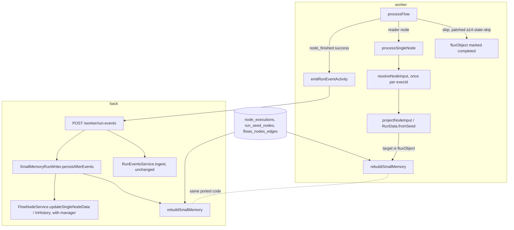

# A14 — Small Memory and chat under the workflow engine, without moving a node

ClickUp: [868mn64jc](https://app.clickup.com/t/9011479430/868mn64jc). **Added 2026-10-23** from
[`NODE-COVERAGE-AUDIT-2026-10-23.md`](./NODE-COVERAGE-AUDIT-2026-10-23.md). **Re-specified
2026-11-23** against back and worker `origin/main`: the first version predates B3b.1, A11, B7b, B6
and the B5 re-spec, and half of its "new logic" already exists. The first version is in git
history.

**Depends on:** B3b.1 (run seed snapshot), B4 and A11 (registry class), all on `main`. Only
`origin/main` is a base: nothing that exists only on `develop` (B6, 868mmhqx4) is a dependency.
If 868mmhqx4 (`writeRuntimeNodeData`) reaches `main` before A14 merges, task A14-B9 switches the
write to it. **No longer depends on A7**: see [Why A7 is not a dependency](#why-a7-is-not-a-dependency).

## Problem statement

A flow that holds a Small Memory node (`fluxObject`) cannot run on the workflow engine. B4's gate
refuses it because its class is `state`, so it stays on the back's loop, and the back's loop can
never be deleted (Wave 6). Where the gate is skipped (batch rows, Temporal schedules), the run
reaches `processFlow`, which has no branch for `fluxObject`: on `main` the workflow task retries
forever; on `develop` B6 fails it with `NodeTypeNotSupported`.

Small Memory does not execute. It is a container: the edge projection appends to it when it is an
edge target and reads from it when it is a source. On the back's loop that state lives in the
loop's memory, and `persistSmallMemoryEntries` writes it to the canvas node so the editor sees it
grow. The workflow engine holds no run memory and has no such write.

## What already works (measured 2026-11-23)

| Piece | Where | State |
|---|---|---|
| Chat history at run start | `prepareRunSessionNodes` (`flux.service.ts:4488-4673`) fills `fluxObject.data.entries` / `userSessionsChat` before the seed; apiV2 persists it through `runSeedService.persist` (`:2287`); batch rows and E4 schedules through `prepareWorkflowSeed` (`:988-1048`) | **Done.** The old part 1 needs no work. |
| Var-input "user" entries | applied with `changeType:'default'` before the seed (`:5048`) | In the seed. |
| Chat answer append | `recordChatLog` (`:1251`), called from `closeWorkerRun` (`:2172`) and the apiV2 finalisation (`:7104`) | **Done** on every workflow path. |
| Reads pinned at scheduling | `completedSourceIds` fixed in workflow state (`process-flow.workflow.ts:209-215`); `completedUpstream` walks through the memory node to its completed producers (`node-input-projection.ts:70`); `fromSeed` re-projects seeded nodes (`project-node-input.ts:158-190`) | Works; the content it rebuilds is empty (gap G1). |
| Registry entry | `node-dispatch-registry.ts:423-431`: `execution:'state'`, `flowDispatch:'inline'`, `backOnlyProjection:true`, `handoffOwner:'A14'` | Exists. The class stays `state`. |

## Gaps this task closes

- **G1. The worker projection never appends to memory.** `projectIntoNode` calls `modifyData`
  without `currentApplyNodeId` / `changeType` (`worker project-node-input.ts:95`); the
  memory-target branch appends only when `allowRegister` is true (`edge-projection.ts:1503`).
- **G2. Producers are visited in edge order**, not completion order.
- **G3. Entries carry a wall-clock stamp.** The back stamps each entry with
  `new Date().toLocaleString` and de-duplicates by content (`edge-projection.ts:1519`, `:1590`);
  non-chat readers receive the stamp in their text. A rebuild cannot reproduce it byte for byte.
- **G4. `processFlow` does not skip `state` nodes.** `skippedNodeIds` uses
  `isWorkflowSkippedNodeType`, which covers only `source` and `visual`
  (`process-flow.workflow.ts:134-141`, `:161`), so `fluxObject` falls into `processSingleNode`.
- **G5. Nothing persists memory on the workflow engine.** `persistSmallMemoryEntries`
  (`flux.service.ts:2723-2761`) runs only in the legacy loop (`:6404`, `:6692`). B4's run events
  reach `POST /worker/run-events`, carry no output, and only insert log rows; apiV2 hydrates after
  `handle.result()` (`:2343-2360`).
- **G6. The gate refuses `state`.** `isWorkflowAcceptedNodeType` (`node-dispatch-registry.ts:568-575`)
  accepts `worker`, `source` / `visual`, and `sink` with a worker module. A11's `it.failing`
  (`engine-selector.spec.ts:97`) documents it.

Chat-mode memory makes no in-run write (`edge-projection.ts:1492` returns the node unchanged), so
chat flows need only G4 and G6. G1–G3 and G5 apply to non-chat memory.

## Goals

- [ ] Every flow that holds a `fluxObject` passes B4's gate and runs on the workflow engine with the
      same answer, the same reader input (under the timestamp rule) and the same persisted memory
      as on the back's loop.
- [ ] No flow that holds a `fluxObject` hangs or fails in `processFlow`, on any entry point (apiV2,
      batch rows, Temporal schedules).
- [ ] `fluxObject` leaves the back-only projection list in back and worker, and the contract is
      regenerated.

## Out of scope

| Item | Reason |
|---|---|
| Moving any node to the worker | The memory is derived; nothing executes. |
| Chat semantics, session keys, what the chatbot shows | Unchanged behaviour is the goal. |
| Two overlapping chat turns on one session | Overwrite each other today; a separate decision. |
| Object Caller (`nodesBox`) object-scope writes, lock and implicit edges | A7. A7 lists the chat scope as A14's (A7 "Out"). |
| Parallel dispatch | B5. This task states what B5 must keep (MEM-08). |

## User stories

### P1: A non-chat Small Memory flow runs on the workflow engine ⭐ MVP

**User story:** As a customer whose flow accumulates values in Small Memory, I want the flow to give
the same result after the `engine_in_workflow` flag is on, so that the engine change is invisible.

**Acceptance criteria:**

1. **MEM-01** WHEN a node that feeds a `fluxObject` completes on the workflow engine THEN the worker
   projection SHALL append its output to the memory content a later reader sees, as the back's loop
   does.
2. **MEM-02** WHEN several producers feed one `fluxObject` THEN the rebuilt content SHALL list their
   entries in completion order.
3. **MEM-03** WHEN an entry is rebuilt THEN its timestamp SHALL follow A14-D2, and
   the parity check SHALL compare everything else byte for byte.
4. **MEM-04** WHEN a reader activity is retried THEN it SHALL read the same memory content as its
   first attempt.
5. **MEM-05** WHEN `processFlow` meets a `fluxObject` THEN it SHALL skip it like a `source` node and
   SHALL NOT dispatch it to `processSingleNode`.

**Independent test:** Run a stored non-chat memory flow on both engines and diff the reader inputs
and the final memory.

### P1: Chat flows with Small Memory run on the workflow engine ⭐ MVP

**User story:** As a customer with a chatbot flow, I want the same answer and the same stored chat
history after the flag is on.

**Acceptance criteria:**

1. **MEM-06** WHEN a chat flow with a `fluxObject` starts on any entry point THEN B4's gate SHALL
   accept it, and the seed SHALL hold the chat history loaded by `prepareRunSessionNodes` (already
   true; covered by a test).
2. **MEM-07** WHEN the run ends THEN the assistant's answer SHALL be appended once through
   `recordChatLog` (already true; covered by a test on each entry point).

### P1: The editor still sees the memory

**User story:** As a flow author, I want to see the Small Memory content on the canvas after a run on
the workflow engine, as after a run on the back's loop.

**Acceptance criteria:**

1. **MEM-08** WHEN a run on the workflow engine writes memory THEN the back SHALL persist it to the
   canvas node through the runtime write path `main` has, the one `persistSmallMemoryEntries`
   uses (`FlowNodeService.updateSingleNodeData` / `updateSingleNodeDataInHistory`). IF 868mmhqx4
   reaches `main` before A14 merges THEN the write SHALL use `writeRuntimeNodeData` /
   `writeRuntimeNodeDataInHistory` instead, so `flows.graph_revision` does not move and no open
   SuperChat proposal goes stale. Timing per A14-D1.
2. **MEM-09** WHEN two writes of one memory node could overlap (B5) THEN the persisted value SHALL
   be the full derivation from the stored rows, never a partial array, so the last write is
   correct whatever the order.

### P1: Registry, gate and contract

1. **MEM-10** WHEN the change ships THEN `fluxObject` SHALL keep `execution:'state'`, SHALL have
   `backOnlyProjection:false` in back and in the worker's ported registry, B4's gate SHALL accept
   `state`, A11's `it.failing` SHALL become a plain test, and `node-dispatch-contract.json` SHALL
   be regenerated.
2. **MEM-11** WHEN `backOnlyProjection` flips THEN the legacy loop with `worker_edge_projection` on
   SHALL keep its current memory behaviour (A14-D4).

## Edge cases

- WHEN a `fluxObject` has no producer THEN readers SHALL see the seed content only.
- WHEN a producer fails THEN its entry SHALL be absent, as on the back's loop.
- WHEN a producer runs inside a loop (`arrayNode`) THEN every iteration's output SHALL be appended;
  `QUERY_FIND_RUN_OUTPUTS` keeps only the latest row per node (`project-node-input.ts:14-19`), so
  the rebuild must read every row.
- WHEN the producer→memory edge is a back edge in a cycle (`scheduler.ts:131-150`, `:247`) THEN B5
  runs the flow sequentially (A14-D3, B5-R12).
- WHEN the same content is produced twice THEN the de-duplication SHALL match the back's
  (`edge-projection.ts:1590`).

## Why A7 is not a dependency

A7's read rule, lock and implicit edges cover Object Caller session writes; A7-D3 says A14 needs no
lock. A14's reads are already pinned by `completedSourceIds`. On B4's sequential engine every
producer completes before its reader is scheduled. Under B5 a memory node's producers are dependency
edges (`classifyEdge`, `scheduler.ts:47-66`), so a reader still waits for them, except across a
back edge in a cycle (A14-D3).

## Decisions (settled 2026-11-23)

| ID | Decision | Settled | Rejected |
|---|---|---|---|
| A14-D1 | When the back persists non-chat memory on the workflow engine | Per producer, during the run, as the full derivation from the stored rows (MEM-09), so the editor sees it grow as today | Once at run end: simpler, but the editor shows the memory only after the run, a visible change |
| A14-D2 | Timestamp of a rebuilt entry | The producer row's completion time, in the back's format; parity ignores the stamp | Wall clock at rebuild: changes on every retry and replay, which breaks MEM-04 |
| A14-D3 | Non-chat memory fed across a back edge in a cycle, under B5 | B5 runs such flows sequentially (B5-R12); count them in production first (measure before refusing) | Accept the difference: results could differ under B5 |
| A14-D4 | The legacy loop when `backOnlyProjection` flips | In scope as a guard: a test proves the legacy loop's memory output does not change | Out of scope: a silent change for flows still on the legacy loop |
| A14-D5 | Does `SmallMemoryRunWriter` persist chat-mode memory | **Revised after R2 (2026-11-23):** yes, once per run: the writer writes the seeded chat history to the memory node's canvas row, as the legacy loop does. The first answer (no) assumed `recordChatLog` owned that write, but `recordChatLog` writes `session_state_entries`, not `flows_nodes` | Keep the first answer: the canvas preview of chat memory differs from the legacy loop |
| A14-D7 | R2 defect: on the workflow engine a Data Output fed by Small Memory gets `[]` (api-v2 reply, canvas, batch `outputDataRaw`, scheduled run, and by code email and callback), because `settleRunOutputs` (`flux.service.ts:1547`) re-projects starter targets from `hydrateRunFromNodeExecutions` (`:1080`), where the memory keeps its seed | Fixed inside A14 (2026-11-23): `hydrateRunFromNodeExecutions` rebuilds non-chat `fluxObject` nodes with `rebuildSmallMemory` over the producer rows, as `SmallMemoryRunWriter` does | A separate task: A14 could not ship before it, because A14's gate change is what sends these flows to the workflow |
| A14-D8 | R2 gap: `source`-class producers (`textBox`, `richTextBox`) feeding `inputAdd` are appended on the legacy loop (`publishInApiNodeOutput`, `flux.service.ts:6673`, `:6385`) and missing on the workflow, which has no row for them | Settled 2026-11-23: every producer is folded in the scheduler's order (`buildSchedulerState`, the product's rule); a `source` producer takes its value from the seed and is stamped with the run start; a worker producer keeps its row's `updatedAt`, and the rows of one node keep their completion order. On B4's sequential engine the scheduler's order equals the completion order, so MEM-02 still holds | Source producers first: differs from the legacy loop when a `textBox` sits after a worker producer |
| A14-D9 | R2 gap: on the legacy loop the memory node gets one `node_executions` row (`recordLegacyNodeStart` / `recordLegacyNodeSuccess`, `flux.service.ts:3749`, `:3898`) and a COMPLETED event with that `execId`, so the Logs page lists it and an open editor fetches its content once; on the workflow it has no row, so an event alone changes only the status | **Revised 2026-11-23:** one row per run and memory, **upserted on every writer write** (created at the first producer, same `execId`, full rebuilt data), so the memory is in the database as early as possible when a back instance is lost mid-run on an on-demand, scaling fleet; the editor's COMPLETED event with that `execId` is sent **once, at run close**, because the front fetches each `execId` once and an early event would show an incomplete memory | One row at run close: lost if the closing instance dies. One row at the last producer: needs to know which producer is last, including dead branches. Status only: no row to query. A row per write: N memory rows on the Logs page |
| A14-D10 | R2b: a user entry that `varInputNode` appends before the seed is stored in jsonb `run_seed_nodes`, which reorders its keys, so a non-chat reader on the workflow gets `{"role":"user","content":…}` where the legacy loop gives `{"content":…,"role":"user"}` (MEM-03 byte parity) | Fixed in A14 (2026-11-24): the rebuild restores seeded entries to the key order of the code that creates them, so the reader's text is byte-identical | Accept the difference: same data, different bytes in prompt text |
| A14-D11 | R2b: a Small Memory with no producer gets no canvas write and no row on the workflow; the legacy loop records a row for every node it visits | Settled 2026-11-24: the run-close fallback also writes memories with no producer, one row per run | Leave it: the Logs page shows one step fewer |
| A14-D12 | The run seed that `loadRunSeedActivity` returns goes into Temporal history whole, so a seed over Temporal's ~2 MB payload limit fails the run (`Complete result exceeds size limit`, HTTP 500) while the legacy loop runs it. Measured: a 2.84 MB memory fails; a 1.87 MB memory passes once and its own write doubles it | Settled 2026-11-24: a temporary guard sends a full run whose seed exceeds 1.5 MB to the legacy loop, which still runs it. Wave 6 deletes the legacy loop, so the slim-seed task (new, Wave 5) must ship before Wave 6 removes that fallback | A slim seed inside A14: about one day of B4 code, and it affects every flow, not only memory flows. Claim-checking the seed to S3: workflow code cannot do I/O, so it only works through a payload codec that re-downloads on every replay and keeps the whole blob in worker RAM. Redis: not durable |
| A14-D13 | Which nodes the rebuild folds into a memory | Settled 2026-11-24: only nodes that are live in this run, computed by replaying the scheduler over the committed rows (success row → completed, error or cancelled row → dead, skipped type → completed, no row → pending). A node that finishes and is an ancestor of a source or producer in the memory's closure also triggers a rewrite. Run-start `varInputNode` entries stay unfiltered, as on the legacy loop | `planOrder`: it marks every reachable node completed, so a dead `textBox` or a memory chained from a dead memory is written to the canvas. `schedState.completed` from `settleSchedulerFromWorkflow` and the worker's `completedSourceIds`: neither holds the live sources |
| A14-D14 | A failure inside the writer | Settled 2026-11-24: it fails the run-events ingest, so `emitRunEventActivity` retries; the writer is idempotent | Log and swallow (the R2 behaviour): the ingest returns 200, nothing retries, and the canvas stays stale until the next write |
| A14-D15 | Repeated full-memory reads and writes per run | Settled 2026-11-24: load a memory only when the event batch affects it, skip the canvas write, the S3 re-upload and the row upsert when the content did not change, and prove with a measurement that peak memory does not grow | Keep the per-event full read: about 16 full-memory reads and 21 S3 uploads per run for a memory with 10 producers |
| A14-D16 | A number or boolean fed into a Small Memory (for example a `scripting` `output` returning `1`) throws `entryContent?.includes is not a function` in the shared `modifyData` branch (`edge-projection.ts:1484` on `main`): legacy fails the run with nothing stored; the workflow retries the writer error for about 156 s, then fails. Found by the B5 dev check on 2026-11-26 (run `9c333a9d`) | Settled 2026-11-26 (A + B): store a number or boolean as `String(value)` in the shared branch, so legacy, the writer and the worker port all store `"1"`; `0`, `false` and `null` stay dropped as today. A programming error in the writer (`TypeError` and similar) is non-retryable, so the run fails at once; a transient error still retries (A14-D14) | Keep the crash on both engines and only fail fast; or open a separate bug task |
| A14-D6 | Runs already stuck on the old `processFlow` path when the `patched('a14-state-skip')` guard ships | Terminate them, listed by an R5 query the user runs (settled 2026-11-23) | Leave them: they retry forever |

## Verification

1. **Negative control (required).** On `main`, force a non-chat memory flow through the workflow
   engine and record the reader's missing content (G1). After the change it matches the back's loop.
2. A batch row and a Temporal-scheduled run with a `fluxObject` hang on `main` and finish after the
   change (G4).
3. Parity over a corpus of stored chat and non-chat memory flows on dev: reader inputs, answer and
   persisted memory match between the engines under A14-D2. The SuperChat F5 golden set is not part
   of the corpus: it exists only on `develop` (`feat/868m8hh5e`) and holds prompts, not stored flows
   (see [Spec deviations](#spec-deviations)).
4. A retried reader activity reads the same content (MEM-04).
5. **Negative control for MEM-08.** Remove the writer call from `WorkerController.ingestRunEvents`
   and watch the canvas test (the live row holds the derived entries after `node_finished`) fail.
   IF A14-B9 runs (868mmhqx4 on `main`) THEN a write through `updateSingleNodeData` moves
   `graph_revision` in a test, which fails.

## Requirement traceability

| ID | Story | Status |
|---|---|---|
| MEM-01 … MEM-04 | Non-chat memory on the workflow engine | In Tasks (B1, B2, W3) |
| MEM-05 | `state` skip in `processFlow` | In Tasks (B3, W2) |
| MEM-06, MEM-07 | Chat flows | In Tasks (B7; already met, tests only) |
| MEM-08, MEM-09 | Editor sees the memory | In Tasks (B5, B6, B8, B9 if 868mmhqx4 reaches `main`) |
| MEM-10 | Registry, gate and contract | In Tasks (B3, W1) |
| MEM-11 | Legacy loop guard | In Tasks (B1, B4) |

**Coverage:** 11 total, 11 mapped to tasks.

## Design

Researched 2026-11-23 against back `origin/main` (`97d1f112`) and worker `origin/main` (`c34de93`).
Nothing that exists only on `develop` is used.

### Architecture overview

Small Memory stays a derived value. One pure function in a ported back file rebuilds it from the
seed and the producer rows; the worker calls it to project reader input, and the back calls it to
write the canvas. Nothing new runs in the workflow except the `state` skip.



### G1–G3: the rebuild (`rebuildSmallMemory`)

**The rule the back applies.** After a node finishes, the back's loop calls `addConnectToNodes`
(`folw/contants.ts`) with `changeType:'execute'`. It calls `modifyData(nodes, id, edges,
objectCallerData, nodeData.id, changeType)` for every source, so `currentApplyNodeId` is the node that
just finished. The memory branch of `modifyData` (`edge-projection.ts`, `fluxObject` branch,
`allowRegister`) registers an entry only when `changeType === 'execute'` and `id ===
currentApplyNodeId`. The in-API path (`publishInApiNodeOutput`) and the Temporal path
(`processNodeViaTemporal` result) both pass the same pair. The worker's `projectIntoNode` passes
`undefined` for both, which is G1.

**The fold.** `rebuildSmallMemory(memory, rows, edges)` starts from the seeded memory node and, for
each producer row in completion order, calls

```ts
modifyData([projected, producerNode], row.nodeId, edgesFromProducerIntoMemory, undefined,
  row.nodeId, 'execute', undefined, row.completedAt)
```

This is the back's own call, one producer at a time, so the append, the empty-entry skip, the chat
early return, the session handling and the content de-duplication (the `entryExists` and
`sessionEntryExists` checks) all come from the ported code. Nothing is restated. Seed entries take
part in the de-duplication exactly as the loop's in-memory entries do. The fold passes no
`iteration`: the memory branch reads `combinedData[memory]['inputAdd'].text`, and the back writer has
no iteration to pass, so both sides fold the same way.

**The timestamp (G3, A14-D2).** The three `new Date().toLocaleString('en-US', {...})` calls in the
memory branch become `formatMemoryEntryTimestamp(entryTime)`, an exported helper in
`edge-projection.ts` that keeps the same options. `modifyData` gains an optional eighth parameter,
`entryTime?: Date`. The legacy loop passes nothing, so it keeps the wall clock (MEM-11). The module
constant `chatTimestamp` (`flux.service.ts`, top of file) holds a second copy of the same format and
imports the helper instead.

**Completion time.** `node_executions` has no finish column. The completion time is `"updatedAt"`:
the worker sets it with the output (`persist-node-outcome.ts`, `QUERY_UPDATE_RUN_NODE`, `"updatedAt" =
now()`), and on `main` nothing in a run writes a finished producer row again. The column is
`timestamp without time zone` holding UTC, so the query reads `"updatedAt" AT TIME ZONE 'UTC'`, which
`pg` parses as an instant whatever the process time zone is. `toLocaleString` then formats in the
process time zone. The back's loop formats in the back's time zone today; neither Dockerfile sets
`TZ`, so both containers run UTC (not verified on the ECS task definitions).

**Completion order and every row (G2, loops).** One SQL constant, exported from the ported
`small-memory.ts` so that back and worker run the same text:

```sql
SELECT "nodeId" AS node_id, "execId"::text AS exec_id, type, "outputData" AS output,
       "updatedAt" AT TIME ZONE 'UTC' AS completed_at
FROM node_executions
WHERE "runId" = $1 AND "flowId" = $2 AND "nodeId" = ANY($3::text[])
  AND "outputData" IS NOT NULL AND "isError" IS NOT TRUE AND "cancelledAt" IS NULL
ORDER BY "updatedAt", "createdAt", id
```

It reads every row of each producer, so every loop iteration appends, and it drops failed and
cancelled rows, so a failed producer leaves no entry. Index: `IDX_NODE_EXECUTIONS_RUN_NODE`
(`runId`, `nodeId`, `createdAt`), the index `QUERY_FIND_RUN_OUTPUTS` already uses; the sort runs over
the few rows of one run. **No new index.** Task A14-B8 confirms the plan with `EXPLAIN ANALYZE`.

**MEM-04 is already structural.** `resolveNodeInput` returns early when the reader's row has
`metadata.inputResolution.resolvedAt` (`resolve-node-input.ts`, `if (row.resolution.resolvedAt)
return;`), so a retried reader reuses the input of its first attempt. The rebuild is also
deterministic for a fixed set of rows, because the stamp comes from the row, not the clock.

### Worker projection (`project-node-input.ts`)

`RunData.fromSeed` already rebuilds a seeded node from its completed upstream nodes. For a seeded node
whose type is `SMALL_MEMORY_TYPE`, it instead:

1. Takes the memory's upstream ids that are in `projection.completedSourceIds`.
2. Runs `SMALL_MEMORY_PRODUCER_ROWS_SQL` for them and resolves each row's output with
   `resolveClaimRef`, as `fromOutput` does.
3. Calls `rebuildSmallMemory`, and adds every row's `exec_id` to `readExecIds`.

Every other target keeps `projectIntoNode`. `completedUpstream` already walks through the memory node
to its producers, because `processFlow` passes `executedNodeIds`, which excludes skipped nodes.

### G4: the `state` skip (`processFlow`)

`isWorkflowSkippedNodeType` (ported registry) returns true for `source`, `visual` **and `state`**.
`fluxObject` is the only `state` type. Because `isWorkflowAcceptedNodeType` already accepts every
skipped type, this one change also opens B4's gate (G6); no second predicate is needed.

In `processFlow`, the skip of a `state` node is guarded by `patched('a14-state-skip')`: a history
recorded before the change, in which a `fluxObject` reached `processSingleNode`, replays the old
path instead of failing with a nondeterminism error. New runs record the marker and skip.

**Base and B6.** Every A14 branch starts from `origin/main` with `--no-track`. B6
(`feat/868m0vmvr`) keeps the same `skippedNodeIds` filter and the same import, so the expected
conflict is small: the `skippedNodeIds` lines in `process-flow.workflow.ts`, and
`src/ported/back/PORTED_FROM.md`, which `pnpm sync:ported-engine` regenerates. Whoever merges second
resolves it.

### G5: the canvas write (A14-D1, MEM-08, MEM-09)

**Options measured.**

| Option | Evidence | Verdict |
|---|---|---|
| (a) A new worker activity or callback after a memory producer | Adds an activity to `processFlow` (new command, needs a patch), a new endpoint and a DTO | Rejected: more moving parts for data the back already receives |
| (b) The back reacts to `node_finished` in `POST /worker/run-events` | `processFlow` emits `node_finished` with `status:'success'`, `execId` and `nodeId` right after the producer's child completes and **awaits** it before it dispatches the next node; the legacy loop never posts run events, so the hook cannot double-write a legacy run | **Chosen** |
| (c) Write once at run end | Contradicts A14-D1 | Rejected by A14-D1 |

**`SmallMemoryRunWriter.persistAfterEvents(events)`** (new back service). For each
`node_finished` event with `status:'success'`:

1. Read the run's memory nodes: the latest `run_substitution_snapshots` row for `runId` (indexed
   `runId`), joined to `run_seed_nodes` on the primary key prefix `snapshotId`, `type =
   'fluxObject'`. Keep the nodes whose `data.chat` is not `true`. When none is left, stop. This is
   the only query most `node_finished` events cost.
2. Read the producer row by (`execId`, `nodeId`) (`IDX_NODE_EXECUTIONS_EXEC_NODE`) for `flowId` and
   `flowVersionHistoryId`, and the edges for (`flow_id`, `flow_version_history_id`), as
   `QUERY_FIND_EDGES` does. Keep the memory nodes the producer feeds on `SMALL_MEMORY_INPUT_HANDLE`.
3. For each such memory node, in one transaction: take
   `pg_advisory_xact_lock(hashtext('small-memory:' || runId || ':' || memoryId))`; read every
   producer's rows with `SMALL_MEMORY_PRODUCER_ROWS_SQL`; resolve claim refs with
   `ExecutionsLogsService.resolveMaybeClaimRef` (as `hydrateRunFromNodeExecutions` does); call
   `rebuildSmallMemory`; write `{ entries, userSessionsChat }` with
   `FlowNodeService.updateSingleNodeData` (live row) or `updateSingleNodeDataInHistory` (when the
   run has a `flowVersionHistoryId`), passing the transaction's `manager`. This is the target rule of
   `persistNodeDataToLiveRow`.
4. Log and swallow a failure, as `persistNodeDataToLiveRow` does, so a canvas write never fails the
   run or the event ingest.

`WorkerController.ingestRunEvents` calls it after `RunEventsService.ingest` returns. The ingest
transaction is unchanged.

**Why the last write is always complete (MEM-09).** Each write reads every row and writes the whole
derivation under a per-memory lock, so two writes never interleave read and write. A producer's row
holds its output before its `node_finished` is posted, so the write triggered by the last producer
reads every row. A write for an earlier producer that runs later still reads every row that exists.
This holds under B5 too.

**Chat memory is skipped.** On the workflow engine, chat memory is already persisted by
`recordChatLog` (tests at `api-v2-data-output-workflow.spec.ts`, "writes the chat_logs record and
the chat memory entries the loop wrote"), and the chat branch of `modifyData` makes no in-run write.
The legacy `persistSmallMemoryEntries` writes chat memory too; on the workflow engine that write
would duplicate `recordChatLog`'s.

**Forward compatibility.** If 868mmhqx4 reaches `main` before A14 merges, A14-B9 replaces the two
`FlowNodeService` calls with `writeRuntimeNodeData` / `writeRuntimeNodeDataInHistory`. On `main`,
`flows.graph_revision` does not exist, so there is nothing to protect yet.

**Side effects and the awaits after them.** The side effect is the `repo.save` inside
`updateSingleNodeData`. After it come `syncAutotriggerFromNodes` (live row only), the transaction
commit, and the controller's return. Tests make each throw after the save and assert that a
redelivery of the same event leaves one derivation (no duplicated entry), and that a failure before
the save writes nothing. The worker retries `emitRunEventActivity` on any non-2xx, so a redelivery
is real.

### G6 and MEM-10: registry, gate and contract

1. `node-dispatch-registry.ts`, `fluxObject`: keep `execution:'state'`, set `backOnlyProjection:
   false`, drop `handoffOwner:'A14'` (`nodeTypesMissingHandoffOwner` asks only for refused types).
2. `isWorkflowSkippedNodeType` covers `state` (see G4).
3. `node-dispatch-drift.spec.ts`: "skips exactly the source and visual types" becomes source,
   visual and state; the literal `BACK_ONLY_PROJECTION_NODE_TYPES` list loses `fluxObject`.
4. `engine-selector.spec.ts`: `it.failing('accepts a flow that holds a state node (A14)')` becomes
   `it`.
5. `pnpm generate:node-dispatch-contract`; `node-dispatch-contract.spec.ts` and
   `node-types-contract.spec.ts` pass.
6. `pnpm sync:ported-engine` copies `edge-projection.ts`, the new `small-memory.ts` (added to
   `PORTED_ENGINE_FILES`) and the registry to the worker; `ported-engine-drift.spec.ts` passes.

### MEM-11: the legacy loop when the flag flips

`openRunInputResolution` (`flux.service.ts`) projects only when `worker_edge_projection` is on and
`backOnlyProjectionNodes(nodes, edges)` is empty. Today a `fluxObject` makes that list non-empty, so
the worker gets the back-resolved input. After the flip, a legacy-loop run of a memory flow (with no
other back-only type) projects in the worker, and its worker-dispatched readers read the memory that
`rebuildSmallMemory` builds.

What does not change: the legacy loop's own in-memory memory, the canvas write
(`persistSmallMemoryEntries`, wall-clock stamps, `entryTime` not passed), and the reader input apart
from the stamp. What changes: a worker-dispatched reader's text carries the producer's completion
time instead of the back's wall clock, which A14-D2 already accepts. The guard test (A14-B4) pins
both facts.

### MEM-06 and MEM-07: chat coverage

| Entry point | Seed holds chat history | `recordChatLog` once | Gate accepts |
|---|---|---|---|
| apiV2 | **Missing** | **Missing** | **Missing** (`it.failing` today) |
| Batch row | Covered: "starts the row in a chat session of its own" | Covered: "writes the chat_logs record…", "retries a failed chat memory append … appends it once" | Not gated |
| Temporal schedule | Covered for variable inputs ("seeds the run with the inputs saved on the schedule"); chat history **missing** | Covered: "writes the chat_logs record and the chat memory entries the loop wrote for a scheduled run" | Not gated |

All in `back/src/app-api/flux/api-v2-data-output-workflow.spec.ts`; `batch-row-run-logs.integration.spec.ts`
covers `recordChatLog` idempotence. A14-B7 adds the three missing tests.

### Data models

```ts
export interface SmallMemoryProducerRow {
  nodeId: string;
  type: string;
  data: Record<string, unknown>;
  completedAt: Date;
}

export interface SmallMemoryNode {
  id: string;
  type: string;
  data: Record<string, unknown>;
}

export function rebuildSmallMemory(
  memory: SmallMemoryNode,
  rows: readonly SmallMemoryProducerRow[],
  edges: ReadonlyArray<{ source: string; target: string; targetHandle: string | null }>,
): SmallMemoryNode;

export function formatMemoryEntryTimestamp(at?: Date): string;
```

### Code reuse

| Reused | Where | How |
|---|---|---|
| `modifyData` memory branch | `back/src/app-api/folw/helpers/edge-projection.ts` (ported) | Called per producer with `currentApplyNodeId` and `'execute'`, as `addConnectToNodes` calls it |
| `SMALL_MEMORY_TYPE`, `SMALL_MEMORY_INPUT_HANDLE` | `back/src/app-api/flux/small-memory.ts` | Ported with the new function |
| `persistNodeDataToLiveRow` target rule | `flux.service.ts` | History row when `flowVersionHistoryId`, live row otherwise |
| `updateSingleNodeData(…, manager)` | `folw/flow-node.service.ts` | Already takes an `EntityManager` |
| `resolveClaimRef` / `resolveMaybeClaimRef` | worker `nodes/shared/resolve-claim-ref.ts`, back `ExecutionsLogsService` | Large outputs |
| `isWorkflowSkippedNodeType` | ported registry | One predicate drives the skip and the gate |
| Integration spec pattern | back `batch-row-run-logs.integration.spec.ts`, worker `project-node-input.integration.spec.ts` | Local Postgres, own schema |
| Workflow test pattern | worker `process-flow.workflow.spec.ts`, `process-flow.replay.spec.ts` | `TestWorkflowEnvironment.createLocal()` and the replay harness |

### Error handling

| Scenario | Handling | User impact |
|---|---|---|
| A producer failed or was cancelled | Its rows are filtered out | No entry, as on the loop |
| A producer row holds a claim ref that cannot be read | Worker: the reader fails with `RESOLUTION_USER_MESSAGE`, as for any source. Back: logged, write skipped | Reader: same as any unreadable source. Canvas: shows the memory after the next producer's write |
| The canvas write fails | Logged and swallowed, as `persistNodeDataToLiveRow` does | The canvas lags until the next write; the run is unaffected |
| A history recorded before the patch | `patched('a14-state-skip')` is false; the old path replays | Same as today for that run |

### Measurement for B5-R12 (production, run by the user)

Production queries go to the user, DBeaver-safe (one statement per file, no `;` or quote in
comments), run first on dev. A14-R5 writes them:

1. **Memory flows.** Live flows (`flows_nodes.flow_version_history_id IS NULL`, `"deletedAt" IS
   NULL`, the flow not deleted) with a `type = 'fluxObject'` node: count all, count non-chat
   (`coalesce(data->>'chat','false') <> 'true'`), and count those that also hold another back-only
   type (`arrayNode`, `fluxBox`, `libraryNode`, `nodesBox`), which A14 does not open.
2. **Back-edge upper bound.** For non-chat memory flows, a recursive CTE over `flows_nodes_edges`
   finds a producer P with an edge P→M on `inputAdd` where P is reachable from M. Every back edge
   into a memory is in this set; the set may hold a few more. The flows it returns are classified
   exactly with `buildSchedulerState` (`scheduler.ts`) on an export, before B5 decides B5-R12.
3. **Stuck runs.** Workflow runs with a `fluxObject` that never finished on `main` (batch rows and
   schedules) are listed so the user can terminate them; the patch keeps them on the old path.

**Production results (2026-11-24).** The user ran the consolidated light query
(`5-a14-light.sql`, replacing `a14-q1`, `q2`, `q3`, `q7` and `q12`) on production:

| Measure | Production |
|---|---|
| Live flows with a Small Memory | 2,672 (2,747 memory nodes): 2,172 chat only, 500 non-chat, 15 mixed |
| Memory flows that also hold another back-only type | 477: `arrayNode` 351, `nodesBox` 127, `fluxBox` 84, `libraryNode` 5 |
| Memory flows A14 opens to the workflow engine | 2,195, of which 134 non-chat |
| B5-R12 back-edge upper bound | 66 of the 500 non-chat flows (437 have an `inputAdd` producer) |
| Unfinished workflow runs with a memory (A14-D6) | 0, and 0 batch files in progress |
| Live schedules on memory flows | 4; they run on the legacy path while `temporal_schedules` is off |
| `run_seeds` rows | 0: `engine_in_workflow` and `temporal_schedules` are both off, and no batch ran since 2026-11-03, so no production run has used the workflow engine yet |
| `flows_nodes` size | 7.5 GB of TOAST, 257k rows |

A14-D6 needs no action: no run is stuck. The 66 flows go to the B5 session for the exact
classification with `buildSchedulerState`.

**Production sizes (2026-11-26).** The user ran `6-a14-sizes.sql` (replacing `a14-q4`, `q5` and
`q6`) on production. Text is the JSON text size of the node data; percentiles are p50, p90 and p99.

| Measure | Non-chat memory | Chat memory |
|---|---|---|
| Live memory nodes | 556 | 2,191 |
| Text p50 / p90 / p99 | 1.5 KB / 39 KB / 304 KB | 152 B / 7.6 KB / 352 KB |
| Text max | 2.14 MB | 13.7 MB |
| Over 256 KB / 1 MB / 1.5 MB / 2 MB | 8 / 1 / 1 / 1 | 28 / 10 / 8 / 8 |
| Entries p99 / max | 181 / 1,261 | 38 / 123 (session entries p99 550, max 25,430) |

| Run seed per live flow | Production |
|---|---|
| Flows | 16,394 |
| Seed p50 / p90 / p99 / max | 56 KB / 213 KB / 2.2 MB / 108 MB |
| Over 1 MB / 1.5 MB / 2 MB | 444 / 286 / 175 |
| Of those, ran in the last 30 days | 44 / 30 / 18 |

With `engine_in_workflow` on, the A14-D12 guard keeps the 286 flows over 1.5 MB on the legacy loop,
30 of them active in the last 30 days, and every flow whose memory alone passes 1.5 MB (one non-chat,
eight chat). B4b must ship before Wave 6 removes that fallback.

### Spec deviations

- **SPEC_DEVIATION 1 (Verification 3).** The SuperChat F5 golden set lives only on `develop`
  (`back origin/feat/868m8hh5e`, `golden-prompts.ts`) and holds prompts, not stored flows. The
  corpus uses stored dev flows only.
- **SPEC_DEVIATION 2 (MEM-11).** The spec says the legacy loop with `worker_edge_projection` on
  "keeps its current memory behaviour". Its canvas memory and its in-memory memory do. The text a
  worker-dispatched reader receives changes only in the stamp, which now follows A14-D2. A14-B4
  asserts both.

### Not verified

- The `TZ` of the back and worker ECS tasks (the Dockerfiles set none).
- That no production path writes a finished producer row's `"updatedAt"` again during a run (code
  read on `main` only).
- The `EXPLAIN ANALYZE` plans of the three writer queries and the producer-rows query (A14-B8).
- The state of `worker_edge_projection` in production.
- How many memory flows also hold `arrayNode` (A14-R5): SuperChat's prompt wires `fluxObject` with
  `arrayNode`, and those flows stay on the loop after A14.

## Tasks

Branches: `feat/868mn64jc` in back and in worker, each a worktree under
`.claude/worktrees/` of the workspace, created with `git worktree add --no-track -b
feat/868mn64jc <path> origin/main`.

**Gates.** Before any build or test run, check `free -m`.

- Back test: `cd back && pnpm test <files> --maxWorkers=1` (the script already sets a 4 GB heap).
- Worker test: `cd worker && NODE_OPTIONS=--max-old-space-size=4096 pnpm jest <files> -w 1`.
- Build: `pnpm build` (`nest build`) in back and in worker.
- Integration specs need the local Postgres (`docker/devdb`, `TYPEORM_*` defaults). Workflow specs
  need `TestWorkflowEnvironment.createLocal()`.
- Never run a full suite or `biome check .`; format with `npx biome check --write <files>`.

Every task that writes code names its negative control: break the code, watch the named test go
red, restore by the inverse edit (not `git checkout`), and record the failure you saw.

### Execution plan

```
Phase 1 (back, parallel)        Phase 2 (back + worker)            Phase 3 (rollout)
  B1 ─→ B2 ─┬─→ B4 ←─┐
            ├─→ B5 ─→ B6 ─→ B9 (only if 868mmhqx4 is on main)
            │    └─→ B8
  B3 [P] ───┼────────┘
            ├─→ B7
  B1,B2,B3 ─┴─→ W1 ─┬─→ W2 [P]
                    └─→ W3 [P]
  B4,B6,B7,B8,W2,W3 ─→ R1 ─→ R2 ─→ R3 ─→ R4
  R5 [P] (no code dependency)
```

### A14-B1: Shared entry timestamp in `modifyData`

- **What:** Export `formatMemoryEntryTimestamp(at = new Date())`; add the optional `entryTime?: Date`
  parameter to `modifyData` and use the helper in the three memory-branch stamps; make
  `chatTimestamp` call the helper.
- **Where:** `back/src/app-api/folw/helpers/edge-projection.ts`; `back/src/app-api/flux/flux.service.ts`
  (`chatTimestamp`).
- **Depends on:** none. **Reuses:** the existing option object.
- **Requirement:** MEM-03, MEM-11.
- **Done when:** with fake timers, a `modifyData` call without `entryTime` stamps exactly the string
  the old inline expression produced; with `entryTime`, it stamps that instant; `chatTimestamp`
  output is unchanged. Negative control: ignore `entryTime` in one branch (session-enabled) and see
  the test fail.
- **Tests:** unit, in `small-memory-input.spec.ts`. **Gate:** back test + back build.
- **Estimate:** 2–3 h.

### A14-B2: `rebuildSmallMemory` and the producer-rows query

- **What:** Add `rebuildSmallMemory`, `SmallMemoryProducerRow`, `SmallMemoryNode` and
  `SMALL_MEMORY_PRODUCER_ROWS_SQL`; add the file to `PORTED_ENGINE_FILES`.
- **Where:** `back/src/app-api/flux/small-memory.ts`; `back/scripts/sync-ported-engine.ts`.
- **Depends on:** B1. **Reuses:** `modifyData`, `SMALL_MEMORY_INPUT_HANDLE`.
- **Requirement:** MEM-01, MEM-02, MEM-03.
- **Done when:** a new `small-memory.spec.ts` proves: two producers appear in row order, not edge
  order; for the same producers in the same order, the entries equal what a fold through
  `addConnectToNodes(…, changeType:'execute')` produces, stamps aside; a repeated content is
  de-duplicated against the seed and against earlier rows; an empty entry is skipped; a chat-mode
  memory is returned unchanged; no rows returns the seed. Negative controls: pass `undefined` for
  `currentApplyNodeId` (the entries vanish, which is G1) and iterate edges instead of rows (the order
  test fails).
- **Tests:** unit. **Gate:** back test + back build.
- **Estimate:** 4–6 h.

### A14-B3: Registry, gate and contract [P]

- **What:** `isWorkflowSkippedNodeType` covers `state`; `fluxObject` gets `backOnlyProjection:false`
  and loses `handoffOwner`; update the drift spec, turn A11's `it.failing` into `it`, update
  `node-input-projection.spec.ts` (`backOnlyProjectionNodes`), regenerate the contract.
- **Where:** `back/src/shared/node-dispatch/node-dispatch-registry.ts`,
  `node-dispatch-drift.spec.ts`, `node-dispatch-contract.json`;
  `back/src/app-api/flux/engine-selector.spec.ts`, `node-input-projection.spec.ts`.
- **Depends on:** none. **Reuses:** `pnpm generate:node-dispatch-contract`.
- **Requirement:** MEM-10, MEM-05 (the predicate), G6.
- **Done when:** `engine-selector.spec.ts`, `node-dispatch-drift.spec.ts`,
  `node-dispatch-contract.spec.ts`, `node-types-contract.spec.ts` and `node-input-projection.spec.ts`
  pass. Negative control: drop `state` from the predicate and see the gate test fail; leave
  `backOnlyProjection:true` and see "never lets the gate accept a type the worker cannot project
  through" fail.
- **Tests:** unit. **Gate:** back test + back build.
- **Estimate:** 2–3 h.

### A14-B4: Legacy-loop guard (A14-D4)

- **What:** A spec that pins the legacy loop's memory after the flip.
- **Where:** `back/src/app-api/flux/small-memory-legacy-guard.spec.ts` (new).
- **Depends on:** B2, B3. **Reuses:** `addConnectToNodes`, `rebuildSmallMemory`,
  `backOnlyProjectionNodes`.
- **Requirement:** MEM-11.
- **Done when:** (1) with fake timers, the legacy fold through `addConnectToNodes` still stamps the
  wall clock and gives the same entries as a fixture written before the change; (2)
  `backOnlyProjectionNodes` of a memory-only flow is empty and of a memory-plus-`arrayNode` flow
  holds only the `arrayNode`; (3) `rebuildSmallMemory` over the same producers gives the same
  entries as (1) with every `timestamp` removed. Negative control: make `addConnectToNodes` pass an
  `entryTime` and see (1) fail.
- **Tests:** unit. **Gate:** back test.
- **Estimate:** 3–4 h.

### A14-B5: `SmallMemoryRunWriter`

- **What:** The service described in G5, with its integration spec.
- **Where:** `back/src/app-api/flux/small-memory-run-writer.service.ts` and
  `small-memory-run-writer.integration.spec.ts` (new).
- **Depends on:** B2. **Reuses:** `rebuildSmallMemory`, `SMALL_MEMORY_PRODUCER_ROWS_SQL`,
  `FlowNodeService.updateSingleNodeData` / `updateSingleNodeDataInHistory`,
  `ExecutionsLogsService.resolveMaybeClaimRef`.
- **Requirement:** MEM-08, MEM-09.
- **Done when**, against local Postgres:
  1. After two producers' `node_finished`, the live row holds both entries in completion order;
     with a `flowVersionHistoryId`, the history row does and the live row does not move.
  2. A chat memory and a run without memory are not written; a run without memory issues one query.
  3. Redelivering the same event leaves one derivation.
  4. Two writers started together for two producers end with both entries (MEM-09).
  5. `syncAutotriggerFromNodes` throwing after the save, and the commit failing, each leave the
     row unchanged or complete, and a redelivery writes one derivation; a failure before the save
     writes nothing.
  6. A 5000-character producer output is written whole.
  7. Negative controls: derive from the event's row only (test 4 fails); drop the lock (test 4
     fails in the interleaving fixture, which holds the first writer's transaction open).
- **Tests:** integration. **Gate:** back test + back build.
- **Estimate:** 8–12 h.

### A14-B6: Call the writer from the run-events endpoint

- **What:** Register `SmallMemoryRunWriter` in the module that provides `WorkerController`, and call
  `persistAfterEvents(body.events)` after `runEventsService.ingest(body)`.
- **Where:** `back/src/temporal/worker.controller.ts` and its module.
- **Depends on:** B5. **Reuses:** the existing controller spec setup.
- **Requirement:** MEM-08.
- **Done when:** `worker.controller.spec.ts` shows the writer called after a successful ingest, not
  called when the ingest throws, and the endpoint returning the ingest result. Negative control:
  remove the call (Verification 5).
- **Tests:** unit. **Gate:** back test + back build.
- **Estimate:** 1–2 h.

### A14-B7: Chat coverage tests

- **What:** The three missing tests from the MEM-06/MEM-07 table.
- **Where:** `back/src/app-api/flux/api-v2-data-output-workflow.spec.ts`.
- **Depends on:** B3. **Reuses:** the spec's apiV2 and schedule harnesses.
- **Requirement:** MEM-06, MEM-07.
- **Done when:** an apiV2 chat flow is routed to the workflow, its persisted seed holds the session
  history `prepareRunSessionNodes` loaded, and the finalisation appends the answer once; a scheduled
  chat flow's seed holds the session history. Negative controls: skip `prepareRunSessionNodes` in the
  apiV2 path and call `recordChatLog` twice; see each test fail.
- **Tests:** unit. **Gate:** back test.
- **Estimate:** 3–4 h.

### A14-B8: Query plans

- **What:** `EXPLAIN ANALYZE` the producer-rows query and the writer's three queries on a realistic
  local copy; record the plans in this file.
- **Where:** this spec.
- **Depends on:** B5.
- **Requirement:** MEM-08, MEM-09 (DB load).
- **Done when:** each plan uses the index named in the Design, or the gap is reported to the user. No
  index is added without the user's decision.
- **Tests:** none (measurement). **Gate:** none.
- **Estimate:** 1 h.

### A14-B9: Switch to `writeRuntimeNodeData` (conditional)

- **What:** Only if 868mmhqx4 is on `origin/main` before A14 merges: replace the two
  `FlowNodeService` calls in the writer with `writeRuntimeNodeData` / `writeRuntimeNodeDataInHistory`.
- **Where:** `small-memory-run-writer.service.ts`.
- **Depends on:** B6.
- **Requirement:** MEM-08.
- **Done when:** a test shows `graph_revision` unchanged after a write. Negative control: call
  `updateSingleNodeData` and see `graph_revision` move.
- **Tests:** integration. **Gate:** back test + back build.
- **Estimate:** 0–2 h.

### A14-W1: Sync the ported engine

- **What:** Run `pnpm sync:ported-engine` from the back worktree with the worker worktree as target.
- **Where:** `worker/src/ported/back/` (`edge-projection.ts`, new `app-api/flux/small-memory.ts`,
  the registry, `PORTED_FROM.md`).
- **Depends on:** B1, B2, B3.
- **Requirement:** MEM-10.
- **Done when:** back `ported-engine-drift.spec.ts` passes against the worker worktree and the
  worker builds. Negative control: edit one ported byte and see the drift spec fail.
- **Tests:** unit (drift spec). **Gate:** back drift spec + worker build.
- **Estimate:** 1 h.

### A14-W2: Skip `state` nodes in `processFlow` [P]

- **What:** Guard the `state` part of the skip with `patched('a14-state-skip')`.
- **Where:** `worker/src/modules/temporal/workflows/process-flow.workflow.ts`; specs
  `process-flow.workflow.spec.ts` and `process-flow.replay.spec.ts`.
- **Depends on:** W1. **Reuses:** `isWorkflowSkippedNodeType`, `executionClassOf`.
- **Requirement:** MEM-05.
- **Done when:** a flow producer → `fluxObject` → reader completes, `processSingleNode` is never
  started for the memory, and the reader's projection lists the producer in
  `completedSourceIds`; the existing replay histories still replay. Negative control: remove the
  skip and see the run fail on the memory node.
- **Tests:** workflow (Temporal test environment). **Gate:** worker test + worker build.
- **Estimate:** 3–5 h.

### A14-W3: Rebuild memory in the worker projection [P]

- **What:** In `RunData.fromSeed`, rebuild a seeded `fluxObject` with the producer rows and
  `rebuildSmallMemory`.
- **Where:** `worker/src/modules/nodes/shared/project-node-input.ts`;
  `project-node-input.integration.spec.ts`.
- **Depends on:** W1. **Reuses:** `SMALL_MEMORY_PRODUCER_ROWS_SQL`, `resolveClaimRef`.
- **Requirement:** MEM-01, MEM-02, MEM-03, MEM-04.
- **Done when**, against local Postgres:
  1. A reader of the memory gets both producers' outputs in completion order, with each stamp
     formatted from the row's `"updatedAt"`.
  2. Two rows of one producer give two entries; a failed row gives none; no producer gives the seed.
  3. Two projections of the same reader return equal data.
  4. A claim-ref output is resolved.
  5. Negative control (Verification 1): restore the `undefined` arguments to `modifyData` and see
     test 1 lose the entries.
- **Tests:** integration. **Gate:** worker test + worker build.
- **Estimate:** 6–9 h.

### A14-R1: Reviews

- **What:** `validate-changes`, then `/simplify`, `/code-review`, `/security-review` on both
  branches; fix; record the outcomes here.
- **Depends on:** B4, B6, B7, B8, W2, W3.
- **Done when:** every finding is fixed or answered here.
- **Estimate:** 2–3 h.

### A14-R2: Local end-to-end on the Docker stack

- **What:** Verification 1, 2 and 4 on the local stack (`docker/devdb`).
- **Depends on:** R1.
- **Done when:** on `main`, a non-chat memory flow forced onto the workflow gives the reader no
  memory content and a batch row and a schedule with a `fluxObject` hang; on the branches, all three
  match the loop under A14-D2 and finish; a retried reader reads the same content.
- **Estimate:** 4–6 h.

### A14-R3: Dev deploy

- **What:** Ask the user for the merge into `develop` (one-off or for the session) and check the
  day's dev freeze; deploy the **worker first**, then the back. The worker must skip `state` before
  the back's gate sends memory flows to it; the writer is safe in either order. Wait for each ECS
  service to settle (one deployment, `COMPLETED`). Record `engine_in_workflow` and
  `worker_edge_projection` on dev before and after.
- **Depends on:** R2.
- **Done when:** both services run the branch tips.
- **Estimate:** 2 h, plus wall-clock waits.

### A14-R4: Dev parity corpus

- **What:** Verification 3 on dev. Find candidates in `flows_nodes` (`type = 'fluxObject'`,
  `data->>'chat'`, live rows), their producers in `flows_nodes_edges` (`target_handle =
  'inputAdd'`), and chat history in `chat_logs`. Copy each flow, turn off Data Output delivery and
  swap recipient inputs, run it with the flag off and on, and diff reader `node_executions.input`,
  the answer, and the memory node's `data.entries` / `userSessionsChat`.
- **Depends on:** R3.
- **Done when:** every flow in the corpus matches under A14-D2, or the difference is reported.
- **Estimate:** 6–10 h.

### A14-R5: Production measurement for B5-R12 [P]

- **What:** Write the three queries of [Measurement for B5-R12](#measurement-for-b5-r12-production-run-by-the-user),
  run them on dev first, and hand them to the user as DBeaver-safe files.
- **Depends on:** none.
- **Done when:** the user has the counts, and this file records them.
- **Estimate:** 2–3 h.

### Estimate

| Part | Tasks | Kind | Min | Avg | Max |
|---|---|---|---|---|---|
| Back code and tests | B1–B9 | code | 24 | 30 | 37 |
| Worker code and tests | W1–W3 | code | 10 | 13 | 15 |
| Reviews, local and dev validation, measurement | R1–R5 | validation | 16 | 20 | 24 |
| Fixes after R2 | B10–B12, W4, R2b | code | 8 | 10 | 12 |
| A14-D10, A14-D11 and R2c | | code | 4 | 5 | 6 |
| Edge-case investigation (2026-11-24) | | validation | 6 | 8 | 10 |
| Fixes after the investigation | B13–B19 | code | 12 | 15 | 18 |
| Second review gate | | validation | 2 | 3 | 4 |
| **Total, uncalibrated** | | | **82** | **104** | **126** |

The first three rows are the estimate of 2026-11-23; the other five are the work added since. Code
totals 58 / 73 / 88 h and validation 24 / 31 / 38 h.

Calibrated with the Wave 5 factors from B5 (code × 0.42 / 0.60 / 0.98, validation × 1.0): code
24.4 / 43.8 / 86.2 h plus validation 24 / 31 / 38 h gives **48 / 75 / 124 h** (it was 30 / 46 / 75 h
before the added work). Re-estimated on 2026-11-24 after the added work: ClickUp holds the calibrated
average, 75 h (it was 32 h).

### Diagram-definition cross-check

| Task | Depends on (body) | Diagram shows | Status |
|---|---|---|---|
| B1 | none | no incoming arrow | ✅ |
| B2 | B1 | B1 → B2 | ✅ |
| B3 | none | no incoming arrow, [P] | ✅ |
| B4 | B2, B3 | B2 → B4, B3 → B4 | ✅ |
| B5 | B2 | B2 → B5 | ✅ |
| B6 | B5 | B5 → B6 | ✅ |
| B7 | B3 | B3 → B7 | ✅ |
| B8 | B5 | B5 → B8 | ✅ |
| B9 | B6 | B6 → B9 | ✅ |
| W1 | B1, B2, B3 | B1,B2,B3 → W1 | ✅ |
| W2 | W1 | W1 → W2, [P] with W3 | ✅ |
| W3 | W1 | W1 → W3, [P] with W2 | ✅ |
| R1 | B4, B6, B7, B8, W2, W3 | all six → R1 | ✅ |
| R2 | R1 | R1 → R2 | ✅ |
| R3 | R2 | R2 → R3 | ✅ |
| R4 | R3 | R3 → R4 | ✅ |
| R5 | none | [P], no arrow | ✅ |

W2 and W3 touch different files and share no mutable test state (W2 uses the Temporal test
environment, W3 its own Postgres schema), so they are parallel. B3 shares no file with B1 or B2.

### Test co-location validation

No `TESTING.md` exists; the matrix below is the repos' practice: pure functions and controllers get
unit specs, DB access gets an integration spec on local Postgres, workflow code gets a Temporal
test-environment spec.

| Task | Layer | Requires | Task says | Status |
|---|---|---|---|---|
| B1 | Ported pure function | unit | unit | ✅ |
| B2 | Ported pure function | unit | unit | ✅ |
| B3 | Registry and contract | unit | unit | ✅ |
| B4 | Legacy-loop guard | unit | unit | ✅ |
| B5 | Service with DB writes | integration | integration | ✅ |
| B6 | Controller | unit | unit | ✅ |
| B7 | Tests only | unit | unit | ✅ |
| B8 | Measurement | none | none | ✅ |
| B9 | Service with DB writes | integration | integration | ✅ |
| W1 | Ported copy | unit (drift) | unit | ✅ |
| W2 | Workflow | workflow | workflow | ✅ |
| W3 | Activity helper with DB reads | integration | integration | ✅ |
| R1–R5 | Validation and rollout | none | none | ✅ |

### Granularity check

| Task | Scope | Status |
|---|---|---|
| B1 | One helper and one parameter in one file, one call site | ✅ |
| B2 | One file (plus one list entry) | ✅ |
| B3 | One registry entry and one predicate; specs and generated contract follow | ⚠️ Cohesive |
| B4 | One spec | ✅ |
| B5 | One service and its spec | ✅ |
| B6 | One call and its provider | ✅ |
| B7 | Three tests in one spec | ✅ |
| B8, B9, W1 | One step each | ✅ |
| W2 | One guard in one workflow | ✅ |
| W3 | One method | ✅ |

### Tasks added after R2 (2026-11-23)

| Id | What | Where | Requirement |
|---|---|---|---|
| A14-B10 | `rebuildSmallMemory` takes `source` producers from the seed and orders every producer by the scheduler (`buildSchedulerState`), source stamps at the run start | back `small-memory.ts` (ported) | A14-D8, MEM-02 |
| A14-B11 | `hydrateRunFromNodeExecutions` rebuilds non-chat memory, so `settleRunOutputs` projects the real content | back `flux.service.ts` | A14-D7 |
| A14-B12 | The writer writes seeded chat history once per run and emits the memory node's socket event after each write | back `small-memory-run-writer.service.ts` | A14-D5, A14-D9 |
| A14-W4 | Sync the ported engine and pass the seed's `source` producers and the scheduler order to the rebuild | worker `project-node-input.ts` | A14-D8 |
| A14-R2b | Re-run R2's failed and differing checks | local stack | MEM-01, MEM-02, A14-D5, A14-D7, A14-D9 |

## Implementation log

Branches `feat/868mn64jc` in back and worker, cut from `origin/main` (back `97d1f112`, worker
`c34de93`) and pushed as they advance. Every new test was seen failing before it counted.

| Task | Commit | Evidence |
|---|---|---|
| B1 | back `cbf01800` | `formatMemoryEntryTimestamp`; `modifyData` takes an optional `entryTime`. 8 tests. Control: ignoring `entryTime` in the existing-session branch fails with the wall-clock stamp. |
| B2 | back `09426be1` | `rebuildSmallMemory`, `SMALL_MEMORY_PRODUCER_ROWS_SQL`, `small-memory.ts` in `PORTED_ENGINE_FILES`. 8 tests. Controls: `undefined` for `currentApplyNodeId` (G1) fails 5; edge order instead of row order fails 3. |
| B3 | back `93fa8af0` | `state` skipped and accepted; `fluxObject` `backOnlyProjection:false`; contract regenerated; A11's `it.failing` is a plain test. 544 tests in the touched folders. |
| B5 | back `98f180d6` | `SmallMemoryRunWriter`, 12 integration tests on local Postgres (order, versioned run, chat skipped, one query without memory, redelivery, two overlapping writers, throw after save, failed commit, failed row left out, 5,000-character output). Six controls, each red. |
| B6 | back `dd7ac7e4` | Writer called from `WorkerController.ingestRunEvents` after `ingest`. Removing the call fails (Verification 5). |
| B4 | back `a630116b` | Legacy-loop guard, 3 tests, proven by three controls. |
| B7 | back `b34d9c41` | apiV2 and schedule chat coverage, 3 tests; controls on `prepareRunSessionNodes` and a double `recordChatLog`. |
| W1 | worker `a6e5cc3` | Ported engine synced from back `93fa8af0`; drift spec passes. W1 alone makes the skip unconditional: never ship it without W2. |
| W2 | worker `467b84d` | Skip behind `patched('a14-state-skip')`; replay of a history recorded on `main` passes, and fails with `TMPRL1100` without the patch. |
| W3 | worker `eb6c87c` | `RunData.fromSeed` rebuilds a seeded `fluxObject`; 7 tests, 6 red before the change. |

**B8 query plans** (local Postgres, in a rolled-back transaction with 72,221 `node_executions`, 24,020
edges, 6,038 snapshots and 78,151 seed rows; no index added):

| Query | Plan | Buffers | Time |
|---|---|---|---|
| Run memory nodes | Index Scan on the `runId` index of the snapshots, then a Bitmap on the seed primary key | 7 | 0.15 ms |
| Producer row | Index Scan `IDX_NODE_EXECUTIONS_RUN_NODE` | 4 | 0.03 ms |
| Edges | Bitmap on the `flow_id` index | 14 | 0.05 ms |
| Producer rows (`SMALL_MEMORY_PRODUCER_ROWS_SQL`) | Custom: Index Scan `IDX_NODE_EXECUTIONS_RUN_NODE` and a sort; generic: BitmapAnd with `IDX_NODE_EXECUTIONS_FLOW_VERSION` | 11 / 18 | 0.07 / 0.2 ms |

**R1 reviews (2026-11-23).** `/simplify`, `/code-review` and `/security-review` on both branches.
Security review found nothing.

| Commit | Change |
|---|---|
| back `0a9d8c4f` | `small-memory.ts` exports `isSmallMemoryInputEdge`, `smallMemoryProducerIds` and `toSmallMemoryProducerRow`, so back and worker pick producers by one rule; the writer loads edges through `FlowEdgeService` and resolves stored outputs before it takes the lock, then re-reads every row under the lock (MEM-09 holds) |
| worker `629c6ba` | Ported engine synced from back `0a9d8c4f` |
| worker `287b3e5` | **Defect fixed:** the projection read every handle, so a node on the memory's `input` handle had its rows read and its exec id reported although it never appends; it now uses `smallMemoryProducerIds` |

Dismissed as the legacy loop's behaviour too: overlapping runs overwrite each other's memory (last
writer wins); a session-enabled non-chat memory writes the visitor's session to the canvas row; the
write emits no socket event. Not a defect on `main`: `recordChatLog` de-duplicates by `claimId` on
queued runs; the B7 harness calls `apiV2` without one.

**Time zone.** Neither repo sets `TZ`, and neither production task definition does
(`api-task-definition-prod:859`, `worker-task-definition-prod:106`, read 2026-11-23), so back and
worker both format stamps in UTC.

**R2 local end-to-end (2026-11-23).** Back `0a9d8c4f` and worker `287b3e5` from the worktrees,
`TZ=UTC`, a local Temporal dev server, each flow through `POST /flux/api-v2` with
`engine_in_workflow` off and on; `mathFunction` producers, no LLM, no delivery. Evidence in the job's
`tmp/a14-r2/out/`.

| Check | Result |
|---|---|
| Non-chat memory: reader input and canvas | Pass: same entries in completion order; stamps equal the producers' `updatedAt` |
| `textBox` / `richTextBox` → `inputAdd` | **Fail** → A14-D8 |
| Node on the `input` handle | Pass: left out on both |
| Chat, two turns, one session | Pass for answers, `session_state_entries` and `chat_logs`; canvas differs → A14-D5 revised |
| Batch (2 rows) and Temporal schedule | Pass: both finish; their outputs hit A14-D7 |
| MEM-04: reader retried after a worker kill | Pass: attempt 2 reused attempt 1's input although a new producer row had landed |
| Claim-ref producer outputs | Pass |
| Session-enabled non-chat memory | Pass, apart from A14-D7 |
| Open editor during the run | **Differs** → A14-D9 |
| Data Output fed by memory | **Fail: `[]`** → A14-D7 |

**Fixes after R2 (2026-11-23).**

| Task | Commit | Evidence |
|---|---|---|
| B10 | back `6d7ac93c` | `rebuildSmallMemoryForRun` folds producers in `planOrder` (the scheduler's rule); a `source` producer takes its seed value, stamped at the seed snapshot's `createdAt` (`SMALL_MEMORY_RUN_SEED_SQL`). Parity test against the legacy order measured in R2. Controls: no source fold, reversed order. |
| B11 | back `8bad8651` | `hydrateRunFromNodeExecutions` rebuilds non-chat memory; the apiV2 reply, delivery and the batch `outputDataRaw` match the legacy loop. Control: no rebuild gives R2's `"text":"[]"`. |
| B12 | back `ff4df8b4` | One `node_executions` row per run and memory, `execId` from run id and memory id, upserted in the canvas save's transaction; chat memory written once per run; one COMPLETED per row from `settleRunOutputs`; hydrate prefers the rebuild over the row. Seven controls. |
| W4 | worker `723e43e`, `3aebce5` | Ported engine synced from back `ff4df8b4`; the worker projection folds source producers in the same order; the memory row is never read as a producer. |

Open after these fixes: a memory fed only by `source` producers (for example `varInputNode` into a
chat memory) gets no canvas write and no row on the workflow, and a memory chained into another
memory is folded by the back but not by the worker. Both are being fixed before R2b.

**Gap fixes and R2b (2026-11-23).** Back `c6ab681b` (a memory chained into another folds as its own
rebuild in this run, matching the legacy loop's `JSON.stringify` of the upstream entries) and
`c37fde7c` (every memory the seed fully decides is written on the run's first `node_finished`, with a
run-close fallback before the COMPLETED announce); worker `1b4d38c` (sync) and `49e2a81`. R2b, back
`c37fde7c` and worker `49e2a81` with `TZ=UTC`: interleaved text boxes, Data Output fed by memory
(apiV2, batch, schedule), chat with `varInputNode` only, one memory row per run (not in flight, no
charge, one row in the run log), one COMPLETED at close with the full content, redelivery
(identical md5), chains, source-only and no-worker runs, and R2's passing checks: all pass on both
engines. Two differences left, settled as A14-D10 and A14-D11.

**A14-D10 and A14-D11 (2026-11-24).** Back `82ec443e` (the rebuild asks `modifyData` which entries
the run start appends, `changeType 'default'`, and puts only those trailing seeded entries back in
the key order that created them; entries stored by earlier runs keep their jsonb order, as on the
legacy loop) and `88af9b1e` (`persistAtRunClose` writes one row, with no canvas write, for a memory
no node feeds when the scheduler's plan reaches it); worker `68e9933` (sync) and `649f117`. R2c with
`TZ=UTC`: run-start user entry bytes, a two-row batch, a memory with no producer, a memory that is not
cleared over three turns with a repeated input, and f2 and f11 again: identical on both engines.

Known edge cases left: a memory that is not cleared, whose last stored entries equal this run's
input, gets those entries in creation order, because the seed cannot tell them from the run-start
append; a memory on a dead branch gets a row, as fed memories already do.

**Edge-case investigation (2026-11-24).** The user asked whether the two edge cases above can leak
memory with flow size, and whether a branch that produced no new output can change a memory.
Evidence: probe specs and local-stack runs (`TZ=UTC`), kept outside this repository.

1. **No leak.** Over 50 runs per scenario, the content is identical on both engines: repeated inputs
   stay at 4 entries (deduplicated by `content`), distinct inputs grow the same on both (200 entries,
   38,344 bytes at run 50), and the A14-D10 reorder never adds an entry. No module-level cache holds
   run or memory data.
2. **A hard ceiling instead (A14-D12).** The run seed carries every node's `data` into Temporal
   history, although `processFlow` uses only `id`, `type`, the edges and the starter. A memory stores
   each entry twice (`entries` and `userSessionsChat.default`); this doubling is on `main` already
   (`edge-projection.ts` non-session branch). With 500-byte entries the ceiling is about 1,800 entries.
   Before A14 every memory flow ran on the legacy loop, so the failure is new for them. A textBox
   with large content reaches the same ceiling today on any workflow run (a B4 limit).
3. **Write and read amplification (A14-D15).** For one run with a 1.1 MB memory, 10 producers and 12
   executable nodes, A14 does about 16 full-memory reads (17.6 MB), 21 S3 uploads (22.5 MB), the same
   11 MB of canvas writes as the legacy loop, and keeps 1.1 MB in `run_seeds.payload`, which no job
   purges. The legacy loop does one canvas read and two S3 uploads.
4. **Dead nodes change the canvas (A14-D13).** `planOrder` covers only reachable nodes, so
   disconnected nodes and loose notes never enter a memory. Nodes after a failed node (reachable
   today) and nodes behind a false condition (once B6 moves `conditionNode`) do: a dead `textBox` and
   a memory chained from a dead memory are written to the canvas permanently, while the legacy loop
   only folds them inside the run or not at all. A memory gated by a dead condition also gets a row
   and a COMPLETED event that the legacy loop does not record.
5. **Writer errors are swallowed (A14-D14).**

Architecture limits outside the refactor: no engine can hold a memory near 1 GB (`jsonb` holds about
255 MB per value, a V8 string about 512 MB), and several steps load a whole memory into one process.
Only storing entries as rows fixes that. It is recorded as a new Wave 5 task, with the slim seed.

### Tasks added after the edge-case investigation (2026-11-24)

| Id | What | Decision |
|---|---|---|
| A14-B13 | Fold only live nodes, from a scheduler replay over committed rows, in the back writer, the run-close write and the worker projection | A14-D13 |
| A14-B14 | Rewrite a memory when a node that precedes one of its sources or producers finishes | A14-D13 |
| A14-B15 | The close fallback and the unfed write record rows only for live memories | A14-D13 |
| A14-B16 | Skip the canvas write when the rebuild equals the stored content; do not repaint a chat memory none of whose producers ran | A14-D15 |
| A14-B17 | A writer failure fails the ingest; test each await after the canvas write throwing | A14-D14 |
| A14-B18 | Load a memory only for batches that affect it; skip unchanged re-uploads; measure peak memory | A14-D15 |
| A14-B19 | Seed-size guard: a full run whose seed exceeds 1.5 MB runs on the legacy loop | A14-D12 |

**B13–B19 results (2026-11-24).** Back `23a396b7` (B13–B18) and `01c2173a` (B19); worker `eedb24b`
(sync) and `27a9aa0`.

- B13: `smallMemoryLiveNodeIds` replays the scheduler over the run's committed outcomes
  (`SMALL_MEMORY_RUN_OUTCOMES_SQL`; a failed row wins over a successful one) with `buildSchedulerState`,
  `nextReady`, `markCompleted` and `markDead`. The back writer, `persistAtRunClose` and hydrate use it
  through `loadSmallMemoryLiveness`; run-start `varInputNode` entries stay unfiltered.
- B14: the writer rewrites a memory when the finished node turns a node of its closure live.
- B15: close and unfed rows go only to memories whose closure holds a live node.
- B16: the writer skips the canvas write, the upload and the row upsert when the stored
  `metadata.contentMd5` equals the new digest; a chat memory's canvas is painted only when a direct
  producer is live.
- B17: `persistAfterEvents` no longer catches, so the ingest fails and the worker retries;
  `persistAtRunClose` still logs.
- B18: peak heap 16.3 MB before and 15.4 MB after for a 1.5 MB memory with 10 producers, retained
  heap flat, 2.4 s to 2.0 s; a redelivery uploads nothing.
- B19: `WORKFLOW_SEED_MAX_BYTES = 1_572_864` in `engine-selector.ts`; apiV2 falls back to
  `legacy_loop` with `seedTooLarge` in the log. Measured: a 2.84 MB memory flow returns HTTP 200 and
  appends its entry, where it returned HTTP 500 before.
- Local stack, both engines: a text box after a failed node, a memory chained from a dead memory and
  the f1, f2 and f11 to f15 regression flows give the same canvas content on both engines.

Deviations: the back replay stops at the first unsettled node, because B4 breaks the run at a failure
and a data edge from a dead node does not kill its target; the worker replays in continue mode,
which is exact for a reader's closure. A memory fed by a live producer that a failed run never
reached still gets a row; its canvas matches the legacy loop. B19 covers apiV2 only: batch rows and
schedules have no legacy path, so a seed over 2 MB fails there until B4b (inferred from the code).

**Second review gate (2026-11-24).** `/simplify` (back `b649b0c8`, worker sync `9c19595`), then
`/code-review` at high effort found two defects, each fixed with a test seen failing first:

1. Worker (`527c4b0`): liveness was built from `completedSourceIds`, which holds only the reader's
   nearest completed ancestors, so a producer behind another node never turned live and the reader got
   `"[]"`. The worker now replays the run's outcomes with the ported rule.
2. Back (`92d12c5d`): one failing memory stopped every memory after it, and nothing retried them at
   close. Each memory is now persisted on its own; at close each failure is logged with its
   `memoryId`, and after an event batch the first failure is rethrown so the ingest retries.

`/security-review` found nothing at confidence 8 or above.

**Per-batch query cost (2026-11-24).** Measured with `EXPLAIN (ANALYZE, BUFFERS)` on a local copy:
50k `run_seeds`, 1.5M `run_seed_nodes`, 1.5M `node_executions` (1.27 GB), runs of 30 nodes with seeds
of 75 KB, 345 KB and 1.5 MB (plain and compressible text). No query scans sequentially, and no index
was added.

| Query at 1.5 MB, warm (plain / compressible) | Before | After |
|---|---|---|
| Run graph | 6.5–8.2 / 36–39 ms | 2.8 / 14.1 ms |
| Batch with a successful `node_finished` | 11.5 / 49.7 ms | 6.2 / 29.9 ms |
| One run of 30 nodes | 0.35 / 1.49 s | 0.19 / 0.90 s |

The run graph used to detoast `run_seeds.payload` three times; it now expands it once with
`jsonb_to_record`, keeping only the edges and the starter in payload order, and takes node ids and
types from `run_seed_nodes` (back `dae1ba8a`, worker `e32e181`). A parity test against the old graph
(seed written by `RunSeedService`, with a starter, a cycle, skipped types and shuffled node order)
was seen failing with the edges reversed and with text boxes dropped. Reading the flow version edges
instead was rejected: a flow without version control reads draft edges, which can change during the
run, and edge order decides the back edge. Getting the graph under 5 ms for a compressible seed needs
a per-snapshot cache or edges stored apart from node data; that belongs to B4b, which separates the
scheduling skeleton from node data. The memory-node read now selects only the snapshot and memory ids
(back `f35e592c`): 7.2–10.0 ms to 0.07–0.34 ms for a 1.8 MB memory, 103 to 8 buffers. No consumer
used the chat flag it fetched; the writer takes it from the run nodes it already loads, and three
existing chat tests went red when the writer lost the flag.

**Follow-ups.**
1. When A14 reaches production, update the workspace `CLAUDE.md` ("Adding or changing a node type",
   item 9): B4's gate then accepts `state`, and `fluxObject` no longer names an owner task.
2. For B5: a node's `updatedAt` can move after its output is written (`recordNodeExecutionMetadata`
   in the counter activity). Completion order is stable under B4's sequential engine; B5 must
   recheck it.
3. For B6: develop's `processFlow` array-body loop sends every body node to `processSingleNode`
   without the main loop's `isWorkflowSkippedNodeType` skip, so a `source`, `visual` or (after A14)
   `state` node inside an `arrayNode` body fails with `NodeTypeNotSupported`. Fixed by worker
   `7fcfcda` on develop before A14's develop push (see R3 below).
4. B5-R12 is implemented on the B5 branch (back `cf96a38`, `hasSmallMemoryOnBackEdge`); its
   production count is the R5-2 query.
5. For B6: when `conditionNode` moves to the worker, the A14-D13 replay must read the taken handle
   from the condition's row.

**Deviations from the Design.** `SmallMemoryEdge` carries `sourceHandle`. The producer lookup adds a
`runId` filter, so it uses `IDX_NODE_EXECUTIONS_RUN_NODE`, not the exec index the Design named. W3's
negative control breaks the worker side instead of the ported file, which the drift check guards.
MEM-04 is covered by the existing second-run test plus a projection-determinism test; a test where a
new producer row lands between two attempts is left to R2.

**R3 dev deploy (2026-11-24).** One develop push per repo for A14 and B5 together, worker first,
after the B6 array-body skip (worker `7fcfcda`, merge `5b94055`) reached develop, which closes
follow-up 3. Develop had drifted from `main`, so the task commits were cherry-picked onto it:
worker `5b94055..62833466` (A14 picks, B5 `0640d98`, the ported sync) and back `7f5baa1a..d5eafa87`
(A14 picks, `e1cc049e` adapting the writer to `writeRuntimeNodeData`, B5 `dd2b85e0`, the regenerated
contract). On develop, apiV2 does not call `persistWorkflowSeed`, so the 1.5 MB seed guard sits in
apiV2's engine decision instead. ECS dev: worker task definition 273 `COMPLETED` at 18:44 UTC, back
2702 at 18:53 UTC. `engine_in_workflow` and `worker_edge_projection` were on in dev before and after.

**R4 dev parity corpus (2026-11-26).** Eleven agents in dev, each run through MCP `run_agent` (a
queued apiV2 job, the same B4 engine decision) with `engine_in_workflow` off and on: 38 runs, all
finished, a `run_seeds` row on every workflow run and none on the legacy runs. Copies have every
delivery off. Evidence: run list and outputs, kept outside this repository.

| Copy | Covers | Result |
|---|---|---|
| F1 | Non-chat memory, LLM producer, not cleared | Match: each run appends only its producer's output; the stamp follows A14-D2 |
| F2 | Chat over two turns, and a non-chat memory feeding a Data Output | Memory matches; the Data Output gets the memory with this run's producer last (A14-D7 holds); answer text differs, see finding 1 |
| F4 | Non-chat memory on a back edge, Data Output | Reader input byte-identical; see finding 2 |
| F5 | Chat, two turns, one session | Match: turn 2 answers from turn 1 on both engines |
| F6 | Memory with no producer, and a chat memory | Match |
| S1–S5 | Synthetic R2c flows: text boxes, chained memory, session-enabled non-chat, `varInputNode` producer, chat with producers | Match, byte-identical with stamps masked |
| X1 | Probe with no memory | Proves finding 1 predates A14 |

Synthetic flows replace stored ones because dev holds no session-enabled non-chat memory, no
`varInputNode` producer and no chained memory (684 live memories, 670 eligible). On the workflow,
every run has one memory row per memory, and its data equals the canvas (A14-D9).

Findings, none in A14's code:

1. **A Data Output with several sources orders its text differently.** The legacy loop appends each
   source as it finishes (`publishInApiNodeOutput`, back develop `flux.service.ts:2787`, called at `:6210`
   and `:6499`); the worker projection walks sources in stored edge order (`projectIntoNode`, worker
   `project-node-input.ts:94-123`). X1 gives "first, second" off and "second, first" on. It predates
   A14 and affects every workflow run whose target has several sources; A14 widens it by sending
   memory flows such as F2 to the workflow, where the answer and the chat entry change. It gates
   `engine_in_workflow` in production, like B4c, and has no task yet.
2. **F4 fails on the legacy loop and completes on the workflow.** Legacy fails at a disabled Output
   Controller ("Internal error", although its row succeeded); the workflow completes with an empty
   output and an unchanged memory. A legacy defect; the stack is in Datadog only.
3. **One or two extra Logs-page steps on the workflow.** In F1, F4 and S1–S4 the legacy loop never
   visits the memory node and writes no row; the workflow writes one per memory, as A14-D9 and
   A14-D11 decided.

Not covered on dev: a batch file and a Temporal schedule (both need a login token; covered locally
in R2, R2b and R2c), and a seed near 1.5 MB (no dev run since the deploy logged a seed above 26 KB;
the only larger memory flow is 1.9 MB and too big to copy through MCP; B19's local evidence stands).

## Files

Back: `folw/helpers/edge-projection.ts` (`formatMemoryEntryTimestamp`, `modifyData`),
`flux/small-memory.ts` (`rebuildSmallMemory`, `SMALL_MEMORY_PRODUCER_ROWS_SQL`),
`flux/small-memory-run-writer.service.ts` (new), `temporal/worker.controller.ts`,
`flux/flux.service.ts` (`chatTimestamp` only), `node-dispatch-registry.ts`,
`node-dispatch-contract.json`, `scripts/sync-ported-engine.ts`, and the specs named in the tasks.
Worker: `process-flow.workflow.ts`, `project-node-input.ts`, and the ported `edge-projection.ts`,
`small-memory.ts` and `node-dispatch-registry.ts`.

## Not verified

How many production flows hold a `fluxObject`, and how many feed it across a back edge; the state of
the `worker_edge_projection` flag; whether the legacy B3b seed holds var-input memory entries.
