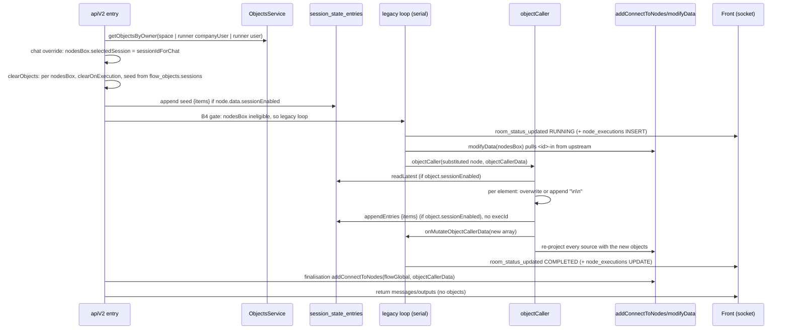

# A7 — How `nodesBox` (Object Caller) and objects work in production today

> **Snapshot.** Dated evidence, read on 2026-10-23 at the SHAs listed under "How this was read".
> Its line numbers go stale; the task spec cites files and symbols (MAINTENANCE §3c).

**Summary**

1. An object is a list of text elements (`flow_objects.text = [{id, text}]`) owned by a space, a company membership or a user; a `nodesBox` node reads it and, per element, appends or overwrites it with the value wired into `<elementId>-in`.
2. Every write lives only in the run's in-memory `objectCallerData`. No run path writes `flow_objects`, so a non-session write disappears when the run ends, and the UI never shows it.
3. Session objects also write a full snapshot row to `session_state_entries`. That row has no `execId` and no `flowId`, and the editor never reads it.
4. Two different flags gate sessions: the node's `data.sessionEnabled` (set by the UI) gates the pre-run seed, and the object's `sessionEnabled` (not set by the current UI) gates the read and the write. Because of this split, the run-to-run behaviour depends on which flag is set.
5. Downstream nodes read the object's current in-memory value whenever any handler re-projects edges, not a value frozen at the `nodesBox` step. Flows that contain `nodesBox` never reach the B4 workflow engine.

**How this was read.** This session could not run `git` against `back`, `worker` or `front`, so it read their working trees instead:

- **Back:** the worktree `868mmj7fj-back`, whose branch points at back `origin/main` `a38fef5`. Every anchor from the brief matches that tree.
- **Worker:** `868m8fnqe-worker`, detached at worker `origin/main` `748d8dc`.
- **Front:** `868mhdzkj-front` (`fix/868mhdzkj`), which is near front `origin/main` `8c52b2d` but not equal to it.
- **Worker B4:** `origin/feat/wave-4-b4` has no checkout, so its code is not read here.

No database was queried. Anchors use `repo:path:line`.

## 1. Data model

### `flow_objects` (entity `UserObject`)

Source: `back:src/entities/user_object.entity.ts:20-104`. One row per object per owner.

| Column | Type | Meaning |
|---|---|---|
| `id` | uuid PK | Row id. It changes on every UI save, because `saveObjects` deletes every row for the owner and re-inserts them (`back:src/app-api/objects/objects.service.ts:69-77`). |
| `objectId` | varchar | The client-generated id that `node.data.selectedId` and `session_state_entries.scopeId` refer to. It is unique only per owner: `@Unique(['objectId','userId'])`, `['objectId','companyUserId']` and `['objectId','spaceId']`. |
| `name`, `isCreating`, `localObject`, `flowId`, `folderId`, `index`, `rank` | — | UI metadata. The runtime ignores `localObject` and `flowId`, so a "local" object is just another object of the same owner. |
| `text` | jsonb `FluxObjectTextItem[]` = `[{id, text}]` | The element list. Each element `id` doubles as the handle ids `<id>-in` and `<id>-out`. |
| `sessionEnabled` | bool, default `false` | The object-level session flag. `objectCaller` and the flow GET read it. The current UI never sets it to `true` (`front:src/store/storeObjects.ts:20`, `CreateItemModal/index.tsx:146`); the other UI paths only copy the existing value. |
| `selectedSession` | varchar, default `'default'` | Last session the UI showed. |
| `sessions` | jsonb `[{id, name, content:[{id,text}]}]` | The legacy per-session content written by the UI. `clearObjects` seeds sessions from this column. |
| `userId` / `companyUserId` / `spaceId` | uuid, nullable | The owner. Exactly one is set. |

Only the UI writes this table. The writers are `back:src/app-api/user/user.controller.ts:155,195`, `back:src/app-api/company_spaces/company_spaces.controller.ts:1003` and `objectsService.seedFromUser` (`objects.service.ts:172`), which copies personal objects into a company membership with the **same `objectId`**.

### `session_state_entries`

Sources: `back:src/entities/session_state_entry.entity.ts:22-115` and the migration `back:src/database/migrations/1776600000000-CreateSessionStateEntries.ts`. The table is append-only. Its columns are `id` (uuid PK), `scopeType` (`'chat'|'object'|'memory'|'counter'`), `scopeId` (for objects, the `objectId`), `sessionKey`, `ownerUserId` (text), `spaceId` (text), `seq` (BIGSERIAL), `role`, `content` (jsonb), `execId` (uuid), `flowId`, `nodeId`, `createdAt`, `updatedAt` and `deletedAt`.

- **Indexes and constraints.** The table has one index, `IDX_SSE_SCOPE_SESSION (scopeType, scopeId, sessionKey, ownerUserId, seq)`, and no unique constraint. Only `setCounterValue` takes a lock (`pg_advisory_xact_lock`, `session-state.service.ts:157`).
- **Object rows.** Each row's `content` is a full snapshot `{items:[{id,text}]}`. `objectCaller` sets `nodeId`, `ownerUserId` (the runner) and `spaceId`, and never sets `execId` or `flowId` (`flux.service.ts:7636-7647` and `9685-9695`).
- **Reads.** `readLatest` returns the newest row by `seq`. It filters by owner only when `ownerUserId` is truthy (`session-state.service.ts:126-144`).
- **Cleanup.** No code calls `clear` for the `object` scope, so object rows grow without bound.
- **Backfill.** `back:src/database/migrations/1776800000000-BackfillSessionState.ts:166-187` copied `flow_objects.sessions` with `ownerUserId = userId ?? companyUser.userId`, which is `NULL` for space-owned objects. Runtime reads filter by the runner's id, so they never return those backfilled rows.

### Session key semantics

- **`objectCaller`:** `node.data.selectedSession || 'default'` (`flux.service.ts:7549`).
- **Full-run override:** `sessionIdForChat = sessionId || (flow has a fluxObject with chat ? 'default' : '')` (`flux.service.ts:3345`). When this value is non-empty, every `nodesBox` gets `selectedSession = sessionIdForChat`, and a missing entry is added to the **node's** `data.sessions` (`flux.service.ts:3437-3470`). The canvas Run always sends `activeSession.id` (`front:src/components/nodes/FlowGlobalNode.tsx:336`). The API, webhook and chatbot send their `sessionId`.
- **`clearObjects`:** `sessionId || 'default'`, where `sessionId` is the raw run parameter, not the node value (`flux.service.ts:9567`).
- **Single node:** the front sends no `sessionId` (`front:src/components/nodes/ObjectCaller.tsx:347-357`), so the run uses the stored `node.data.selectedSession`, usually `'default'`. The session that the node's selector shows plays no part.
- **Isolation:** rows are keyed by the runner (`ownerUserId = u.id`), not by the object's owner, so each member of a space has separate session state for a shared object. Chatbot runs use the flow owner as `user` (`flux.controller.ts:1233-1242`), so all chatbot visitors share an owner and differ only by `sessionKey`.

### Who reads `session_state_entries` with scope `object`

| Reader | Anchor | Effect |
|---|---|---|
| Back `objectCaller` | `back:src/app-api/flux/flux.service.ts:7555-7562` | Reads the latest snapshot when `object.sessionEnabled` is set, then appends a new snapshot. |
| Back `clearObjects` | `flux.service.ts:9683-9696` | Writes only. It appends a seed snapshot when `node.data.sessionEnabled` is set. |
| Back flow GET `syncObjectCallerData` | `back:src/app-api/folw/flow.controller.ts:1086-1135` (called at 1297 and 1353) | Reads the latest snapshot, then mutates a local object array that the controller discards. The only visible effect is `node.data.selectedSession`. |
| Worker `shared/session-store.ts` | `worker:src/modules/nodes/shared/session-store.ts:21-120` | Does not read objects. It reads only the `memory` and `counter` scopes. |
| Front | — | Does not read it. The editor reads `flow_objects.text` and `flow_objects.sessions` only (`front:src/views/CoreNodeDisplay.tsx:515-575`). |
| MCP (`back/src/app-mcp`, `mcp-server`) | — | Does not read it, and has no tool that lists or reads objects. |

## 2. Node data shape

The front component is `ObjectCaller` (`front:src/util/nodeTypes.tsx:76`, `front:src/components/nodes/ObjectCaller.tsx`). Its `data.*` fields:

| Field | Set by | Meaning |
|---|---|---|
| `selectedId` | Object select, `onChange(..,'selectedId')` (`ObjectCaller.tsx:85`) | The `objectId` the node reads and writes. |
| `<itemId>-in` | Edge projection only (`back:src/app-api/folw/helpers/edge-projection.ts:1651-1700`) | The value to write. Several edges into one handle are joined with `\n\n`. The element box shows the **object** text, not this field, so you cannot type it. Placeholders in this field are substituted before the write (`applySubstitutionToObject`, `flux.service.ts:4203`). |
| `<itemId>checked` | "Append / Overwrite" switch (`ObjectCaller.tsx:781-808`) | `true` means overwrite; `false` or missing means append. |
| `<itemId>clearOnExecution` | "Clear output upon run" switch (`ObjectCaller.tsx:765-772`) | Blanks the element at the start of every full run. |
| `sessionEnabled` | "Agent Session Mode" switch (`front:.../FluxObjects/SettingsModal.tsx:160-173`) | This is a **node** flag, not an object flag. |
| `selectedSession`, `sessions` | Back run override, flow GET normalisation (`flow.controller.ts:1014-1027`), front session store | Session bookkeeping. The `sessions` list feeds the canvas session selector (`flow.controller.ts:924`). |
| `errorMessage`, `errorAt`, `errorStatusCode` | `objectCaller` resets them to `null` | — |

The handles are `<itemId>-in` (target) and `<itemId>-out` (source), plus the generic `input` and `outputFlow` (`back:src/app-mcp/node-types/node-handle-registry.ts:739-760`).

The MCP entry is `back:src/app-mcp/node-types/node-type-metadata.ts:955-977`. It exposes only `selectedId` and `sessionEnabled`, and describes the node as calling "a stored user-defined JSON object". It omits `-in`, `checked`, `clearOnExecution` and `selectedSession`, and its `outputSchema` is `{}`.

## 3. Lifecycle of one full run (`apiV2`, legacy loop)

1. **Load the objects** (`flux.service.ts:3261-3284`). The owner is `spaceId` when the flow's folder is in a space. Otherwise it is the runner's `companyUser` for `userFound.selectedCompanyId`, falling back to `userId`. `toJsonArray` maps `objectId` to `id` (`objects.service.ts:43-57`).
2. **Apply the chat override** (`3342-3474`), as described in section 1.
3. **Run `clearObjects`** (`3570`, body `9552-9700`). For each `nodesBox` whose `selectedId` exists, whether or not the node will run:
   1. If `node.data.sessionEnabled` is set, the function synthesises a `'default'` legacy session from `text` when none exists. It then takes the session `sessionId||'default'` from `flow_objects.sessions`, or blanks `text` when that session is missing.
   2. It blanks the elements whose `<id>clearOnExecution` is set.
   3. It stores the result in memory. If `node.data.sessionEnabled` is set, it also **appends that seed as the newest session row**.
4. **Choose the engine** (`3766-3800`). `canUseWorkflowForFlow` returns `false` for any flow that contains `nodesBox`, because the registry marks it `flowDispatch: 'inline'` (`back:src/app-api/flux/engine-selector.ts:12-29`, `node-dispatch-registry.ts:204-209`). With B4's global `engine_in_workflow` flag on or off, these flows run in the legacy loop. Prefetch mode would apply, since `prefetchSafe: true`, but `FLUX_EXEC_MEMORY_MODE` has been `legacy` in production since 2026-08-20 (`TASK-B3-WORKER-INPUT-RESOLUTION.md:50`).
5. **Run the node** (the `while` loop at `3871`, one node at a time; the `nodesBox` branch is at `4194-4221`):
   1. `recordLegacyNodeStart` inserts the `node_executions` row and emits `RUNNING` (`3945`, `2308-2376`).
   2. `modifyData` merges the inbound `-in` values.
   3. `applySubstitutionToObject` resolves placeholders in the node data.
   4. `objectCaller` runs (`7533-7670`). If the object is not found, nothing changes and no error is raised. For a session object (`object.sessionEnabled`), the element text comes from `readLatest`, then the legacy `object.sessions` content, else blank. Elements are de-duplicated by id. For each element: overwrite gives `text = data['<id>-in']`, even when that value is `undefined`; append gives `old + '\n\n' + new`, or `new` when `old` is empty, or `old` when `new` is empty.
   5. For a session object, `appendEntries` stores `{items}`.
   6. `onMutateObjectCallerData` swaps the run's array. `objectCaller` also mutates the selected object in place.
   7. `addConnectToNodes` re-projects every edge source (`back:src/app-api/folw/contants.ts:1588-1626`).
6. **Feed the downstream nodes.** `getOutputByType` resolves a `nodesBox` source by testing whether the **id string contains** `'nodesBox'`. It looks up `objectCallerData.find(id === selectedId)`, emits `{label, id: <nodeId>$<itemId>-out, text}`, and accumulates entries into `contentIn`, `promptIn`, `personaIn` and any `outputObjectNode` handle (`edge-projection.ts:46-84`).
   - Because every handler's `addConnectToNodes` re-projects all sources, a consumer sees the object's value **as of the last projection before it runs**. That value includes writes by any later `nodesBox` on the same object.
   - Object values cannot be referenced with `{{…}}` placeholders, because `nodesBox` has no entry in `NODE_REFERENCEABLE_FIELDS`.
7. **Finalise** (`5751-5765`). One more `addConnectToNodes(…, objectCallerData)` runs from the global starter, the `outputObjectNode` live rows are persisted, and chat history goes to `session_state_entries` for the `fluxObject` chat nodes (`5831-5895`). The response carries messages and outputs, never objects (`5903-5925`).
8. **Front during and after the run.** The front receives only per-node `room_status_updated` statuses (`emitNodeStatus`, `2945-2972`) and fetches node output from `node_executions`.
   - The object panel keeps showing the `flow_objects` value. At Run, the canvas also blanks the clear-on-run elements in the local store only (`front:src/util/autosave/utilis.ts:904-927`). The stored value returns on reload.

**Loop body** (`4870-4900`). This path is identical, and it is re-run once per `arrayNode` item, so appends accumulate once per item. For a session object, each iteration does one `readLatest` and one append.

**Single node** (`executeSingleNode` at `1288`, then `runLegacyAndPersist` at `1455`, then `dispatchLegacyHandler` at `1823-1850`):

- This path has no `clearObjects` and no chat override.
- It loads objects with `space ? {spaceId} : {userId}` (`1660`).
- `onMutateObjectCallerData` is a no-op (`1670`), so a non-session write has no effect at all.
- It persists `finalData` to the live `flows_nodes` row (`1530`).
- The front's former client-side write path, `_legacyOnSubmit` (`ObjectCaller.tsx:121`, which saved to `flow_objects`), is dead code.

**Prefetch** (off in production). It dispatches through the same `dispatchLegacyHandler`, so objects are reloaded from the database for every node and the writes never reach later nodes (`1983-2012`).

## 4. Execution records

| Path | Row and anchor | `execId` | `runId` / `metadata.runId` | `input` | `outputData` / `output` |
|---|---|---|---|---|---|
| Full run | INSERT `recordLegacyNodeStart` (`2341`), UPDATE `recordLegacyNodeSuccess` (`2492`, called at `5395`) | New uuid per node (`3893`) | `runLogProcessId`; `metadata {runKind:'agent', runType, runId}`; `sessionId = sessionId\|\|'default'` | `processedNode.data` (substituted node data, including the projected `-in` values) | The node's data after the step (`selectedId`, `-in`, flags, null errors). `output` = `toText(data.text)`, which is `null`, because `nodesBox` has no `text` field (`back:src/shared/node-output/extract-node-output.ts:27`). |
| Loop body | Batch INSERT `insertInlineNodeExecutions` (`2440`, added at `5041`), **only when the run-log event recorder is on** (`4488`) | Per iteration (`4566`) | Same as the full run | `processedNode.data` | Node data |
| Single node | INSERT `createNodeExecution` (`1389`, `990`), UPDATE (`1507`) | New uuid | `runId = execId`; `{runKind:'node', runType:'single-node'}`; `sessionId = ''` | The substituted node data **before** inbound projection | `finalData`, which includes the merged `-in` values |
| Prefetch (off) | `openPrefetchNodeExecution` (`1896`), UPDATE (`2043`) | The run's id | `runType:'apiV2-prefetch'` | Resolved input | `finalData` |

**Can you recover the object's value at the time of the node from the database?**

- **Non-session objects: no.** The run-time value lives only in memory. `flow_objects` holds the UI-saved base, has no history, and gets new row ids on every save. The only trace is indirect: the downstream nodes' `node_executions.input` holds the projected text (for example in `contentData`), as of each consumer's own projection.
- **Session objects: partly.** The post-write snapshot is in `session_state_entries` (`content.items`, `nodeId`, `createdAt`, `sessionKey`, `ownerUserId`). The pre-write value is the previous row in the same scope. The row has no `execId` and no `flowId`, so you can attribute it to a run only by matching `nodeId` and `createdAt` against `node_executions`, and concurrent runs or sub-flows on the same key make that match ambiguous. The seed rows that `clearObjects` appends are also indistinguishable from write rows, apart from their `nodeId`.

## 5. Other readers of objects or `objectCallerData`

- **Every inline handler.** All inline handlers pass `objectCallerData` to `addConnectToNodes`, so any node's step re-projects the `nodesBox` edges (for example `flux.service.ts:3976-4353`, `6121`, `6237`).
- **`modifyData` targets.** `fluxBox` and `libraryNode` read object values through `textData[<varInputId>]` and `fileLinkData[...]` (`edge-projection.ts:1213-1310`). Typed nodes receive `<field>Data` entries `{id:'<nodesBoxId>$<itemId>-out', label, text}`. `outputObjectNode` always accumulates them.
- **Single-node variables.** For `scripting` and `mathFunction`, `resolveInboundVariables` reads objects that it loads with `space ? {spaceId} : {userId}` (`flux.service.ts:1353-1368`, `helpers/resolve-inbound-variables.ts:3`).
- **`fluxObject`.** This node is chat memory, not an object. It shares only `session_state_entries` (scope `chat`), the session id, and the chat override block. It does not read `objectCallerData`.
- **Sub-flows (`fluxBox`, `libraryNode`).** These start a separate `apiV2` (`6250`, `6609`) that reloads objects from its own owner and runs its own `clearObjects`. The parent's in-memory array is never passed down or refreshed afterwards.
- **Worker.** The worker never reads objects. `project-node-input.ts:94` passes `undefined` as `objectCallerData`. Any connected `nodesBox` turns off worker edge projection for the **whole run** (`back:src/app-api/flux/node-input-projection.ts:6-14,48-58`, `flux.service.ts:1031-1036`).
- **Front.** The editor's own client projection reads the zustand object store (`front:src/util/autosave/utilis.ts:121-140`).

## 6. Concurrency today

| Scenario | Can readLatest→append interleave? | What is lost |
|---|---|---|
| Two `nodesBox` nodes in one run | No. The legacy loop awaits each node (`3871`), so the order follows the scheduler. | Nothing. The later node sees the earlier write. |
| Two runs of one flow, same `sessionKey`, same runner, session object | Yes. There is no lock and no `seq` check. Each run's `clearObjects` also appends a seed row. | The last append wins and the other run's write disappears from "latest". A run that starts mid-way resets the base under an in-flight run. |
| Two runs, non-session object | No shared state | Nothing to lose. Each run starts from `flow_objects`, and nothing persists. |
| Different runners, same space object | No. Rows are keyed by `ownerUserId`. | Nothing. Each user has a separate state. |
| Sub-flow (`fluxBox`) on the same object | Yes, against the parent's later writes | Non-session writes are invisible across the boundary in both directions. The child's `clearObjects` seed can overwrite the parent's session base. The parent's projections stay stale until its next `nodesBox` on that object reads the latest row. |
| Recursive or enqueued flow calls | Yes. These are concurrent runs (see the earlier row). | Same as two runs. |
| Chatbot, same session | Yes, when the messages overlap | Lost update. All visitors share the flow owner as `ownerUserId`. |
| Chatbot, different sessions | No | Nothing. |
| `/flux/batch-process` | No within one batch. Rows are serial (`flux.controller.ts:783-831`) and run with `user = flow.user` and no `sessionId`. | A batch can interleave with another run on `'default'`. |
| Single node and full run at the same time | Yes. Single node writes the node's stored session (`'default'`), and the full run writes `sessionId`. | Lost update on `'default'`. |

## 7. Inconsistencies between paths

| # | Inconsistency | Evidence |
|---|---|---|
| 1 | The owner resolution differs. The full run uses space, then the runner's **current `selectedCompanyId`** company membership, then the user. Single node, variable resolution and the flow GET use space, then the user. A personal flow can therefore load different objects, or none, depending on the company the runner last selected. | `flux.service.ts:3261-3279` vs `1660`, `1355`; `flow.controller.ts:1094` |
| 2 | The session gate is split. `clearObjects` uses `node.data.sessionEnabled`, while `objectCaller` and the flow GET use `object.sessionEnabled`. The UI sets only the node flag. | `9580`, `9684` vs `7555`, `7569`; `flow.controller.ts:1108`; `SettingsModal.tsx:166` |
| 3 | The effect of the gate split follows from the code (not reproduced at run time). Node flag only: the seed rows are written and the engine never reads them. Both flags: each run re-seeds "latest" from `flow_objects.sessions`, so the run writes from earlier turns are not carried forward. Object flag only: the writes accumulate across runs. | `9578-9640`, `7555-7590` |
| 4 | The session key source differs. `clearObjects` uses the run's `sessionId`, `objectCaller` uses `node.data.selectedSession`, and single node ignores the session that the UI selector shows. | `9567`, `7549`; `ObjectCaller.tsx:347-357` |
| 5 | Write visibility differs. The full run and the loop keep writes in memory. Single node and prefetch use a no-op `onMutateObjectCallerData`. | `3282`, `1670` |
| 6 | `execId` and `flowId` are never set on object session rows. `spaceId` is `''` on single node and `undefined` on the full run for flows outside a space. | `7636-7647`, `9685-9695`, `1425` |
| 7 | `node_executions` stores node data, not the object value, and `output` is `null`. | `extract-node-output.ts:27` |
| 8 | Overwrite with no input blanks the element on the back. The dead front path kept the old text. | `7606-7618` vs `ObjectCaller.tsx:128-140` |
| 9 | The UI reads only `flow_objects`, so the session writes of a run are invisible in the editor. | `CoreNodeDisplay.tsx:515-575` |
| 10 | A `nodesBox` source is detected by an id substring, while targets use `type`. | `edge-projection.ts:46` vs `1651` |
| 11 | The MCP schema misdescribes the node, omits the write fields, and offers no way to discover an object id. | `node-type-metadata.ts:955-977` |
| 12 | `scopeId = objectId`, and `seedFromUser` copies `objectId` from a user to a company membership, so the personal and company copies share session rows for the same runner. | `objects.service.ts:172-199` |
| 13 | The backfilled object session rows of space objects have `ownerUserId NULL`, so runtime reads never return them. | `1776800000000-BackfillSessionState.ts:183` |
| 14 | Loop-body `nodesBox` executions are recorded only when run-log events are on. | `4488` |
| 15 | No spec tests `objectCaller` or `clearObjects`. | `grep` over `back/src/**/*.spec.ts` |

## 8. Facts a redesign must preserve

1. Each element is written independently. Append joins with a blank line (`\n\n`), and an empty input leaves the element unchanged. Overwrite replaces the element, and an empty input blanks it.
2. Several edges into one element input are joined with `\n\n` before the write.
3. A write is visible to every later node in the same run, including consumers wired to a different `nodesBox` that reads the same object.
4. A run never changes the stored object that the user sees in the panel. A non-session object is effectively a template that every run starts from.
5. "Clear output upon run" blanks the element at run start for the whole run, even when that `nodesBox` never executes.
6. Inside an array loop, an append accumulates once per item.
7. Session content is keyed by the run's session id (chat, API or canvas session), and each runner has separate state for a shared space object.
8. A missing or deleted object makes the node a silent no-op: the node completes, and its downstream handles get no entry.
9. Downstream entries keep the id `<nodesBoxId>$<itemId>-out` and the node's `label`, and `outputObjectNode` accumulates them. Element ids are the handle ids.
10. Objects resolve by the owner scope at run time: the space, else the runner's selected company, else the user. Changing this rule changes which object a personal flow reads.
11. `nodesBox` runs in back, inline and serially. Today the B4 workflow, the worker projection and the worker modules never see it.

**Open questions that need production counts (not run, by rule).**

- How many `flow_objects` rows have `sessionEnabled = true`?
- How many `nodesBox` nodes have `data.sessionEnabled = true`, and on which object configuration?
- How many `session_state_entries` rows have `scopeType = 'object'`, and how many of those come from seeds versus writes?

These counts decide whether the behaviour in rows 2 and 3 of section 7 is a dormant path or a live one.
